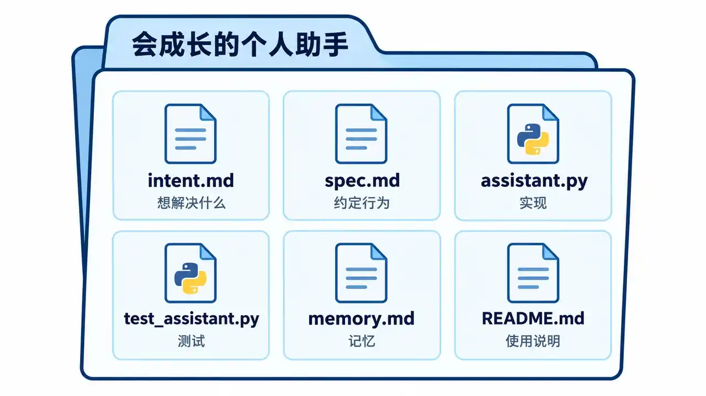
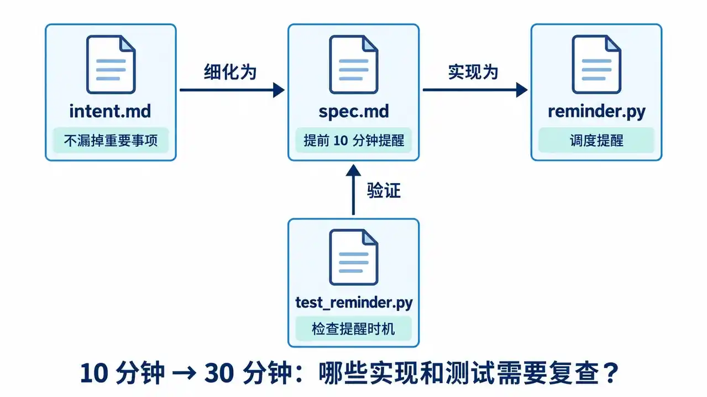
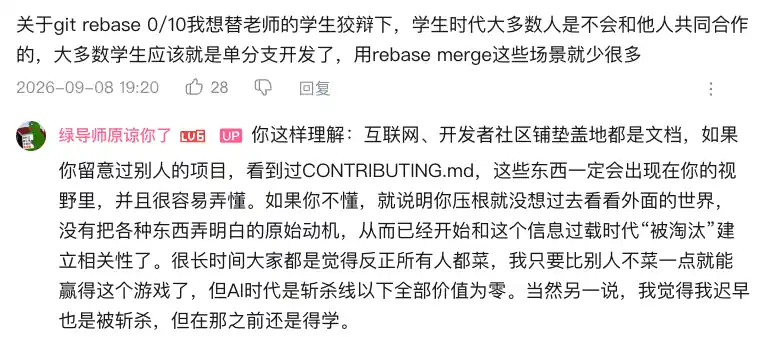
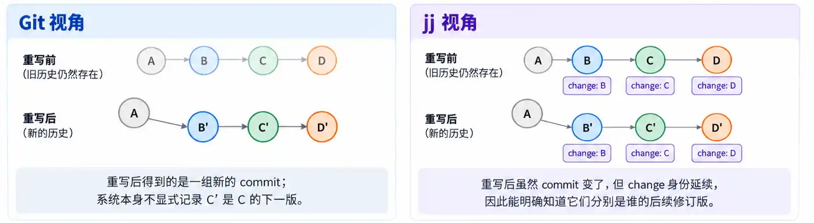
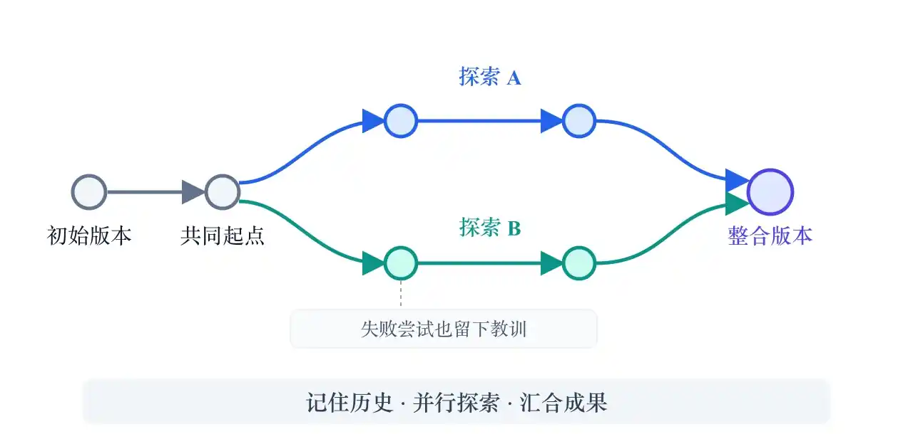
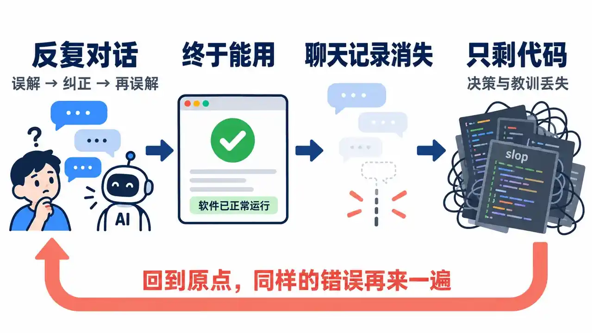

# 第 4 讲 · 版本管理 (2)

> 来源: https://jyywiki.cn/GSE/2026/slides4.html  
> 共 25 页 · 由 slides4.html 的 slides-data 提取

---

## 第 1 页

# Review & Comments

## [Lab1](https://jyywiki.cn/GSE/2026/lab1.md)：会成长的个人助手

  * 一个非常 “时髦” 的需求
  * 以**能帮上自己** 为目标
    * “成长”的验收：这次纠正，下次还能生效。

## 第 2 页

# 项目是各种文件的集合

## Intent、Spec、Code、…

## 第 3 页

# 文件装得下什么？

## 文件系统的方便

  * 其实 “文件” 只是文件系统的方便
    * 其他形式 (例如 db) 对人类和工具都不太友好
  * 但丢失了很多文件不适合表达的信息，例如 artifact 之间的 [traceability](https://dl.acm.org/doi/10.1145/2593882.2593891)

## 第 4 页

# 将错就错，然后呢？

## 基于文件的工具蓬勃发展

  * 从压缩包到 SVN、Git、…
  * 人类只能将错就错

## AI 时代的软件形态

  * 推论：AI 时代 “软件” 的形态会发生根本的变化

## 第 5 页

# Git 管理了什么？

## 文件、目录、快照和快照之间的关系

  * A + `feat: ...` → B
  * Merge A, B → C

## 并行开发与冲突

  * 不同人在快照上分别开发，自然会带来冲突
    * Merge v.s. rebase
    * Merge 汇合历史；[rebase](https://git-scm.com/book/en/v2/Git-Branching-Rebasing) 把修改依次重放到新的起点。

## 第 6 页

# 同学产生的疑问

## 从信任老师到自己的理解

  * 典型的 “学生思维” (信任老师)
    * 老师不教的就是我不需要会的
    * 考试不考的就是我不用学的
  * 学习的目的：形成**自己的理解** (first principles)

## 第 7 页

# 如果想重新设计版本管理系统？

## Git 经常需要处理 commit 之间的 delta (change)

  * Cherry-pick, rebase, ...
  * 但这是用 commit 来替代的 (感觉到轻微的不和谐了？)

## 我们究竟想操作什么？

  * “把这次修改搬到另一个版本上”——我们关心的是 **change** 。
  * 这次修改换了一个起点，它还是不是“同一次修改”？

## 第 8 页

# 把 Change 作为 First-Class Citizen

## 祝贺，你发明了 [Jujutsu—a version control system](https://www.jj-vcs.dev/latest/)

  * Rebase 不应该让同一次 change 失去身份。
  * **Commit ID 会变，change ID 延续** ：同一次修改，可以有不同的修订版本。[设计说明](https://github.com/jj-vcs/jj/blob/main/docs/tutorial.md)

## 第 9 页

# 让未完成的工作也有位置

## 连 staging area 都不需要了

  * 仿佛一直在 commit + amend。
    * 工作副本本身就是一个 commit；多数 `jj` 命令会自动记录文件修改，更新这个 commit。[工作副本](https://github.com/jj-vcs/jj/blob/main/docs/working-copy.md)

## 冲突直接存进 commit (killer feature!)

  * Rebase 可以直接完成，之后再统一处理冲突。
  * 保存的是冲突的逻辑表示；带着冲突的 commit 仍能继续 rebase、merge。[冲突管理](https://www.jj-vcs.dev/latest/conflicts/)
  * 设计启发：把“尚未解决”表达成一种可保存、可继续操作的状态。

## 第 10 页

# 这就是为什么 AI Native 能淘汰老登

## 已经形成的肌肉记忆

  * 我已经形成 Git 的肌肉记忆了。
  * 即便能理解，也没有足够的时间训练另一个肌肉记忆。
  * 熟悉的解法会锁住注意力：棋手说在寻找更优解，目光却仍围绕旧套路。[Einstellung effect，2008 年眼动实验](https://pubmed.ncbi.nlm.nih.gov/18565505/)

## 同学们的学习方向是反过来的

  * **先理解正确的设计，再回望历史** 。
    * 理解我们是如何一路走来 (更高效)。

## 第 11 页

# Agent 时代，再次重新设计版本管理系统

## 人类是 “Single-Threaded” 生物

  * 我们只有**一份** I/O 设备：一双手、一张嘴、一对眼睛

## Git 基本够一个人用了

  * stash：把手头的工作放一边，先处理另一件事
  * branch：保留不同方向的尝试，切换着推进
  * Jujutsu 就更好用了

## 第 12 页

# 但如果是 Agent Team (Swarm) 呢？

## 单个 Agent 快，Agent 还可以并行 😂

  * 单个 Agent 工作的速度就显著比人更快：分钟级产生一个原子提交
  * Agent 还可以并行

## Git “为人设计” 的模型跟不上这个速度了

  * 一个工作目录里，A 正在修改，B 就可能读到一半的结果
  * 现在需要一起加速的，还有协调、验证与整合

## 第 13 页

# 把每个 Agent 当成独立开发者

## 每个 Agent 有自己的开发计算机，用 Remote 同步

  * 这个流程能不能放到本地？
  * Yes! 我们有了 [git worktree](https://git-scm.com/docs/git-worktree)

## 一个仓库，多个工作目录

  * 每个 worktree 有自己的工作文件、HEAD 和 index (暂存区)
  * 共享对象库和分支引用：提交在本地直接可见，无需互相 push/pull
  * 给 Agent A 创建分支和工作目录：`git worktree add -b agent-a ../gense-agent-a`
  * 给 Agent B 创建分支和工作目录：`git worktree add -b agent-b ../gense-agent-b`
  * 各自在自己的目录干活；修改仍需 merge/rebase 才会汇合

## 第 14 页

# 回到为什么需要版本控制

## 人的限制，塑造了工具

  * 人的生产效率有限
  * 人之间有 communication gap：实际上沟通效率极低
  * 人就算沟通了，也可能各种出错
    * 快照、小步前进：bisect、blame……

## 如果没有 Agent 能被开除、能坐牢？

我们**再也不要 blame** ，只要把问题默默修了就好？

  * 历史的价值可以从“谁写错了”转向“哪次变化破坏了什么，怎样恢复”
  * 跨领域先例：[NASA 航空安全报告系统](https://asrs.arc.nasa.gov/publications/callback/cb_555.html)通过自愿、保密、非惩罚性的报告收集安全隐患，帮助防止重演

## 第 15 页

# 主 Agent 规划，子 Agent 上锁开干

## Agent 只干一件事：推进一件事，把屁股都擦干净

  * 主 Agent 负责规划
  * 子 Agent 负责上锁开干
    * Agents 完全可以直接上互斥锁，把活干了，解锁

## 把协调放到什么时候？

  * Git/Jujutsu 像是“事后”的 Multi-Version Concurrency Control：冲突检测，类似数据库
  * 互斥锁：修改前先约定谁能访问这份共享状态，把冲突变成等待

## 第 16 页

# 学《操作系统》、《数据库》有用了吧

## “把活干完”，边界在哪里？

  * 锁保护的是一件事依赖的共享状态；只锁正在写的文件，可能漏掉别人正在改的接口
  * 约定：上锁 → 读取最新状态 → 修改 → 验证并留下可恢复的快照 → 解锁
  * 和数据库的 [advisory locks](https://www.postgresql.org/docs/17/explicit-locking.html#ADVISORY-LOCKS) 一样，参与访问的 Agent 都要遵守协议；锁不会自动让错误的修改变正确

## 重新思考 Fundamental 的问题

这就是为什么我喜欢上课——它会强迫我把很多 fundamental 的问题想得更清楚

## 第 17 页

# 团队协作

## 版本控制只是工具

真正的困难还是在**进度 (团队) 管理** 。

## AI 是一条“斩杀线”

  * 如果一句话就能直出高质量产品，软件工程就直接**死了**
  * Moore's Law (也是一种 Scaling Law) 还成立，模型就有机会更强、更小、更快
  * 如果一个岗位 100% 的工作都能被 AI 替代，这个人在这个岗位上的价值在哪里？
    * 从某种意义上，被斩杀的数学工作者更惨 😂

## 第 18 页

# 团队的复杂性

## 人数增加，沟通关系平方级上升

大家都有体验：明明自己非常明白，但很难说服别人。

$n$ 个人，两两之间就有 $\frac{n(n-1)}{2}$ 条潜在沟通关系：5 人是 10 条，10 人是 45 条。见 [Brooks《人月神话》](https://www.cs.virginia.edu/~evans/greatworks/mythical.pdf)。

## “我的部分已经好了”

  * **目标不一致** ：你要赶紧上线，我要趁机重构；两个人都觉得自己在帮项目
  * **依赖在等待** ：前端等接口，后端等需求；每个人都很忙，关键路径却没动
  * **完成的定义不同** ：我的代码能跑，你以为已经能交付；一集成才发现各自理解不同
  * **责任落在缝隙里** ：接口、测试、部署都“有人负责”，跨模块的问题却没人认领

## 第 19 页

# 版本控制留给我们的启发

## 项目可以不仅是“当前状态”

## 技术会过时，First Principles 会留下

能够看到开发的历史、记住教训 (也许会被 Agent Memory 替代)，也能管理多个并行探索，并最终合并。

## 第 20 页

# 再次回到 Pico Playground

## 小学生的 Tower of Hanoi

  * 考了个不容易的题目，一片哀嚎
  * 如果为了挣 ¥¥¥，我们当然应该提供**增值服务**
    * 在服务器端保存小朋友的做题记录

## GPT：数据库启动

> 一个 API 应用、一个关系数据库、一个对象存储；需要异步点评时再加后台任务进程。数据库存关系和记录，大课程包与完整轨迹放对象存储。任务量小时，数据库任务表就够用。

## 第 21 页

# 但 Git 不刚好适合这个吗？

## GPT 也没想到

  * **树状的版本历史** ：做到哪一步、从哪里重试，都可以留下来
  * **免费的 Diff 功能** ：前后两次提交，到底改了什么？
  * **Comment Commit** ：把点评关联到当时的版本；[`git notes`](https://git-scm.com/docs/git-notes/2.42.0.html) 可以后补点评，不改原提交

## 记录“怎么做出来的”

汉诺塔只保存最终盘面，看不出孩子在哪里卡住；保存动作序列，才能回放、比较和点评。

把动作保存成逐行文本，Git 就能提供版本与差异；“哪一步值得表扬”，仍然要由应用理解。

## 第 22 页

# 开始做一个项目

## 你就是包工头

不如我们直接拿 Lab 开干吧！

  * 任何时候，**开始都比不开始强**

## 从零开始：连需求都还没对齐

  * “从零开始做产品” 的难度比 “参与一个成熟开源项目” 大 (intent-spec-impl gap)
    * 任何 “确定” 的东西，都可能是把对需求的**误解** 固定下来
  * 准则：没有什么是不能变的，能不能以不变应万变？
    * 其实就是：你的软件能否抵抗**需求的变化** ？

## 第 23 页

# Vibe Coding：回到原点，又踩一遍坑

## 记住现在、记住历史、记住教训

代码记住结果，[决策记录](https://cognitect.com/blog/2011/11/15/documenting-architecture-decisions)记住“为什么这样做、哪些路走不通”。

## 第 24 页

# 用 MVP 验证需求

## Minimum Viable Product：用一个最小的版本验证

> The biggest risk in product development is building something nobody wants.

  * MVP 会给你一个**立即能使用、不完备** 的版本
  * 帮助你考虑未来潜在的变化、评估软件的设计

## 先验证什么？

  * 先选一个最值得验证的假设，再做能验证它的最小版本。([Eric Ries：MVP](https://leanstartup.co/resources/articles/what-is-an-mvp/))

## 第 25 页

# 早期的 Prompt，影响最大

## 每一次“确定”，都在影响项目的走向

  * 早期的 prompt 对项目的走向影响**最大**
  * 任何 “确定” 的设计 → 潜在的 technical debt

## 留下历史，让可用版本反过来帮助设计

  * 自动提交 & push → 可留痕的历史
  * 可用的版本还可以帮助你**重新整理架构设计**

