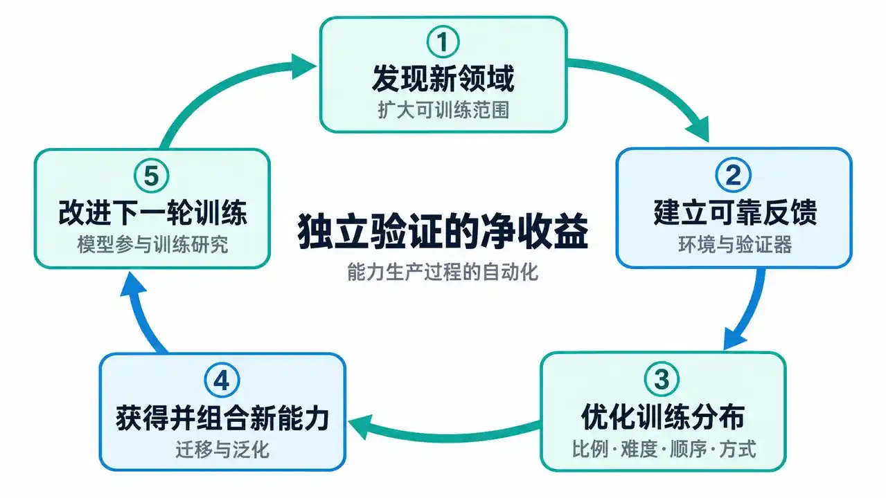
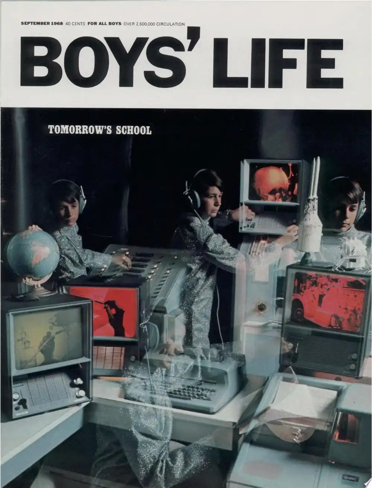
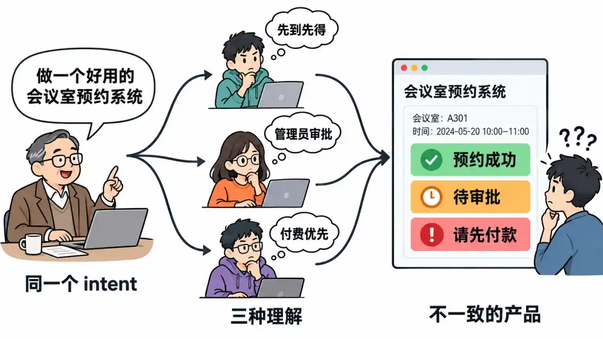
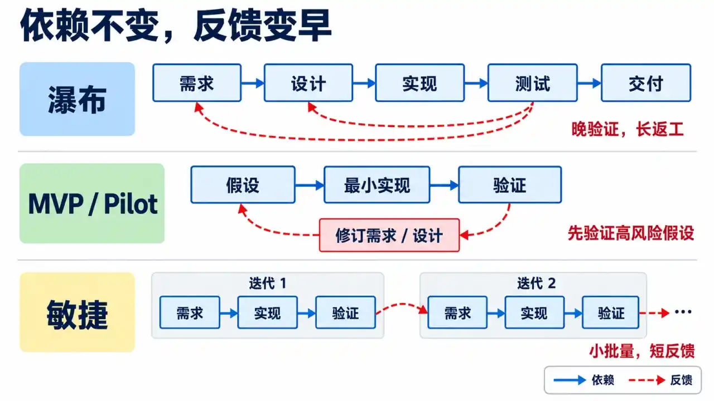
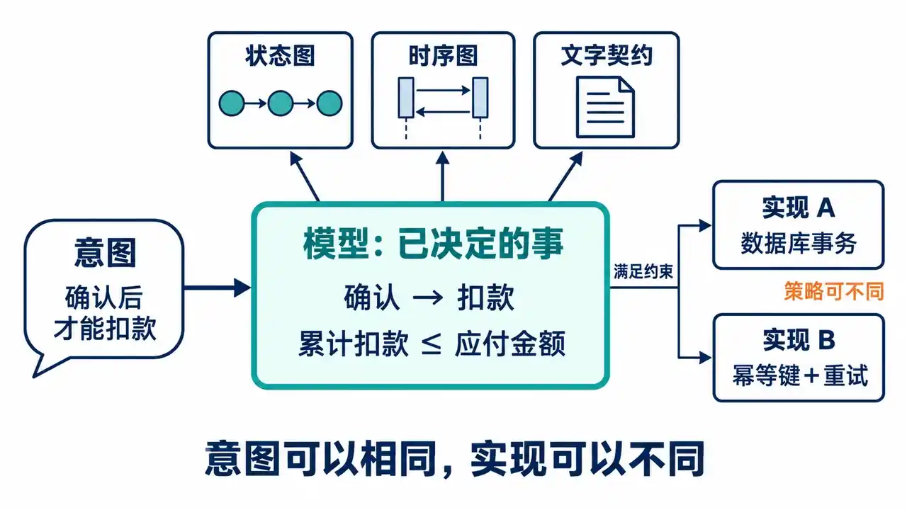

# 第 5 讲 · 软件工程

> 来源: https://jyywiki.cn/GSE/2026/slides5.html  
> 共 39 页 · 由 slides5.html 的 slides-data 提取

---

## 第 1 页

# Review & Comments

## 摧毁性的事情一直都在发生

  * Typesafe AI 的 [Jev](https://www.bilibili.com/video/BV1x1ex6TEFu/)

    * 我猜是一个 prefill only 的 transformer 😂
      * 官方披露：一次并行输出全部概率，无需逐 token 自回归生成。见 [技术介绍](https://typesafe.ai/blog/introducing-system-one-models-and-jev)。
    * System I (人类意义上的实时决策)

## 感受一下 [AI 进化的速度](https://www.bilibili.com/video/BV1B6YR6gEyd/)

  * 很难想象 [Sillcon Valley](https://www.bilibili.com/bangumi/play/ep817870/?share_source=copy_web&t=1374) 里的 Pied Piper 到今天会怎么样
  * 以及我们每个人在就业市场上面临的挑战

## 第 2 页

# 工作性质在改变

## OpenAI Noam Brown 的访谈

  * 如果 AI 能做一个人 **90%** 的工作，那个人的注意力就会集中到 AI 做不好的 **10%** 上
  * Taste (“**对接下来该做什么** ” 的直觉)：他预计，一两代模型之后就比他强了
    * “可验证” v.s. “不可验证”

## 第 3 页

# The Bitter Lesson

## OpenAI All In RSI

  * [The Bitter Lesson](https://www.cs.utexas.edu/~eunsol/courses/data/bitter_lesson.pdf)

    * “数据分布工程”的飞轮

## 支撑新一轮 Scaling Law：数据分布工程

  * **学什么、何时学** ：在什么阶段，接触哪些经验
  * **怎样学** ：比例、难度、顺序与训练方式
  * **持续调整** ：根据学习进展、跨域迁移与泛化表现，改变训练分布
    * [DoReMi](https://arxiv.org/abs/2305.10429) 的实验：某领域的训练占比降低后，该领域的困惑度仍然可以改善

## 第 4 页

# 数据分布工程的飞轮

## 自动化能力生产过程

  * 增强后的模型参与寻找领域、构建环境与验证器，并优化数据分布与训练方法。

## 第 5 页

# 增加可训练领域

## 把更多智力活动变成可以规模化训练的对象

  * **空间变换、图形规则归纳、几何构造**
    * 生成器与约束检查：构造任务，验证结果
  * **系统架构、并发协议、故障诊断**
    * 运行、模型检查、故障注入与需求变化：检验方案
  * **主动实验、记忆管理、需求澄清**
    * 后续预测与任务结果：评价此前的选择

## 第 6 页

# Review: 版本管理

## 软件是 Intent、Spec、Impl 的组合体

  * 以文件系统快照的形式存储 (版本管理)
  * 所谓“软件开发”，就是不断推出新的版本，直到满足客户需求
    * 这其中很自然会遇到分叉、冲突……
    * 于是你能理解 SVN、Git、Jujutsu、……的设计原因

## 从零开始构造软件

  * 上次起了个头：从空的项目 (模糊的 intent) 开始，我们可以做什么？

## 第 7 页

# 今天的答案：直接做一个 MVP

## Office Assistant (GLM-5.3 直出)

  * “软件” 公司的彻底消亡 (Jev, 豆包手机, ...)
  * 以后可以想象：说好需求，自动下单零部件，3D 打印定制件，回家 Lab 就建好了

## 第 8 页

# 今天的内容

## 但其实曾经的软件工程不是这样的 😁

  * 有必要了解一下“构造软件”的历史中，大家发现、发明了什么
    * 软件工程的诞生
    * 软件工程的智慧
    * UML

## 第 9 页

# 软件还是新生事物的年代

## 回到 1960s：昂贵的码农

  * 码农很贵：越早，编程工具越不成熟，码农越贵
    * 高智力需求的工种，成本极高
    * 当然那时候硬件更贵 😂
  * 码农还经常缺少对客户的同理心、商业的理解等“软技能”，也不懂业务

## 把客户的需求翻译成软件系统

  * 软件企业的任务是把**客户** 的需求翻译成软件系统
    * 客户不理解计算机能做什么
    * Intent-spec-impl gap 天然存在
  * 这还是个年轻的职业：Dijkstra 回忆，1957 年结婚登记时，“程序员”不被承认为职业，最后登记成了“理论物理学家”。[本人回忆](https://www.cs.utexas.edu/~EWD/transcriptions/EWD03xx/EWD340.html)

## 第 10 页

# 1968 年想象中的“明日学校”

## 计算机可以怎样教学生？

  * 《Boys’ Life》1968 年 9 月号：终端即时判分，针对薄弱环节辅导，让学生按自己的节奏学习。[封面与原刊](https://books.google.com/books?id=gmA305LImsYC&printsec=frontcover) · [Computerized School House，第 24 页](https://books.google.com/books?id=gmA305LImsYC&pg=PA24)

  * 课堂思考：“因材施教”是意图；程序怎样判断学生已经学会？

## 第 11 页

# 软件工程和其他工程的区别

## 需求是高度定制化的

  * 需求是**高度定制化** 的
    * 也因此一直认为是高度需要人类智慧的 (编程，谁学谁知道)
  * 以“选课系统”为例，同一个功能名称，可能对应完全不同的规则
    * 名额先到先得、抽签，还是按专业保留？
    * 不满足先修课要求时，老师能否特批？谁负责批准？
    * 退课空出的名额交给候补队首，还是重新开放抢课？

## 程序也在执行客户的制度与例外

  * 这些选择决定了谁能选上课。我们的理解：业务规则与责任边界，本身就是要构造的软件的一部分。

## 第 12 页

# Software Crisis

## 进度、成本、质量一起失控

  * 软件开发进度无法预测
  * 软件开发成本崩溃
  * 质量、维护都是问题

## E. W. Dijkstra 的“暴论”

  * [暴论](https://homepages.cwi.nl/~storm/teaching/reader/Dijkstra68.pdf)：Go To Statement Considered Harmful（1968）
    * 挑衅性的开场：程序员的水平随程序中 goto 密度上升而下降；背后的关切是**人的推理能力有限，程序结构应帮助人理解执行过程** 。
  * [The Humble Programmer](https://www.cs.utexas.edu/~EWD/transcriptions/EWD03xx/EWD340.html)（1972 ACM Turing Lecture）
    * 硬件越强，社会越敢提出更大的目标；新的野心把软件开发推向能力边界。

## 第 13 页

# “软件工程”成为共同议题

## 1968 年：一场刻意的“挑衅”

  * 1968 年 10 月，50 多位专家在德国 Garmisch 参加 NATO 软件工程会议。[会议报告，Background](https://www.scrummanager.com/files/nato1968e.pdf)
  * “Software Engineering”被刻意选作带挑衅意味的名称：软件生产也应有成熟工程学科的**理论基础与实践纪律** 。[报告前言](https://www.scrummanager.com/files/nato1968e.pdf)

## 连“危机”也有争议

  * 会上有人反对一概而论：排序、工资处理已有成熟办法；困难集中在规模和要求超出已有经验的系统。[会议讨论，§7.1.2](https://www.scrummanager.com/files/nato1968e.pdf)
  * 由此理解“危机”：过去成功的经验，未必能支撑下一种规模与野心。

## 第 14 页

# 把软件当作工程：Apollo

## Margaret Hamilton 与她的团队

  * [Margaret Hamilton](https://www.technologyreview.com/2019/08/16/579/)
    * 领导 MIT 仪器实验室的软件工程部门，参与 Apollo 飞行软件开发，推动软件工程观念获得承认。[NASA／MIT 介绍](https://science.nasa.gov/people/margaret-hamilton/)

## “能工作”还包括发生意外的时候

  * Apollo 11 登月下降时，计算机过载，出现 1201／1202 警报。[亲历者解释](https://history.nasa.gov/wp-content/uploads/static/history/alsj/a11/a11.1201-pa.html)
    * 软件的优先级与恢复机制，让关键的下降控制任务得以继续。
    * MIT 团队事先充分测试过恢复能力，地面团队才有依据判断可以继续登月。
  * 这个案例里的工程工作包括：决定必须保住什么、实现恢复机制，并验证它确实有效。

## 第 15 页

# 软件工程的诞生

## 在成本、时间等约束下交付软件

  * 在成本、时间等约束下，把人的意图变成可工作的软件系统。

    * 从大到团队组织管理，小到代码风格都会覆盖的学科

## IEEE：把工程应用于软件

> IEEE: (1) The application of a systematic, disciplined, quantifiable approach to the development, operation, and maintenance of software; that is, the application of engineering to software. (2) The study of approaches as in (1).

  * 系统化、有纪律、可量化；覆盖开发、运行与维护。

## 第 16 页

# 软件工程的智慧

## 回到 Pre-LLM 时代

  * 接到开发任务，肯定不能立即安排码农干活——虽然最终产物是他们生产的
  * 如何减少 **intent-spec-impl gap** 带来的影响？

## 第 17 页

# Royce 与瀑布模型

## 如何按时、不超预算地交付大型软件？

  * Winston Royce: [Managing the development of large software systems](https://dl.acm.org/doi/10.5555/41765.41801)

    * 这篇论文画出了后来被称为“瀑布模型”的经典阶段图
    * 1970 年的背景：航天器任务规划、指令与飞行后分析，时间和存储都有硬约束。
    * 原文在这张图之后就指出：这样的实施方式风险很高，容易失败。

## “瀑布假设”

  * 希望迭代只发生在**相邻阶段** 之间
  * 实际测试中暴露的问题，却会一路回溯到**设计与需求**

## 第 18 页

# AI 时代的一手信息

## 我的 AI 阅读助手：[royce.md](embedded/slides5-royce.md)

  * 每个人都可以阅读**一手信息** ，直接代入历史背景
  * 理解产生的原因，复原学科逻辑

## 谁来决定知识怎样压缩？

  * 过去：查证知识网络非常费时，需要教科书“**有损压缩** ”
  * 现在：自己建立无损知识网络，**按需压缩**
  * 你说 [101 计划](https://www.proj101.cn/)是不是 💊

  * 例如：只留下那张瀑布图，就丢掉了作者接下来要解决的返工问题。

## 第 19 页

# Testing：第一次“被经历”

## 全文最锋利的观察

  * Testing 是 **timing / storage / I/O** 第一次“被经历”，而非“被分析”的地方
  * Royce 的观察：这些系统行为难以在实际运行前精确分析
  * 如果实际运行不满足约束，局部修补代码往往不够

## 代价沿着依赖一路向上

> 不满足约束 → 大改设计 → 推翻需求基线 → 一切重来

  * 成本、进度可能翻倍
  * 例如：正确算出结果，却赶不上控制周期；算法正确，也无法挽救系统设计。

## 第 20 页

# Do It Twice

## 用今天的 MVP 理解 Royce 的 Pilot Model

  * Minimum Viable Product：先做一遍，从中学习，再完善产品
  * Royce 的 **do it twice** ：先用 pilot model 经历关键问题
  * Pilot 重点验证技术与运行风险；[MVP](https://www.startuplessonslearned.com/2010/09/good-enough-never-is-or-is-it.html) 更关注用最小投入验证用户与业务假设。

## 用敏捷开发理解“反复做 Pilot”

  * 不必把 pilot 单独隔成一个大阶段，而是把试做、反馈、修正反复快速做
  * 共同点：让关键假设尽早遇到证据；[敏捷原则](https://agilemanifesto.org/principles)将频繁交付、合作与调整变成持续过程。

## 第 21 页

# 瀑布模型就是 Data Dependency Graph

## 需求分析 → 系统设计 → 系统实现 → 测试验证 → 交付维护

  * 不做需求（intent / spec），设计就会漂移
  * 设计（spec）错了，实现就会漂移
  * 没有实现（impl），谁会想去测试？
  * 当然，交付之后还得有人擦屁股

## TDD：拿 Testcase 当需求与设计

  * 后来大家才反应过来：可以先写 testcase
  * 写下预期行为只需要需求；验证实现是否满足预期，才需要实现。
  * **产物之间有依赖，不等于所有阶段只能完整地做一遍。**

## 第 22 页

# 用 Data Dependency 理解开发过程

## MVP 与敏捷：让反馈更早回来

  * 比较的不只是阶段顺序，还有：**多晚才得到反馈，得到反馈时已经做了多少依赖它的工作。**

## 第 23 页

# 阅读“开天辟地”的经典

## 即便今天已经过时，通常仍然信息量巨大

  * 经典记录了一个领域最初遇到的问题，以及怎样找到出路。
  * 在今天的背景下，反而非常容易理解

## 带着今天的经验，回到当年的问题

  * 读 Royce 时，可以追问：哪条建议来自当年的硬件约束，哪条来自多人协作，哪条来自“必须运行以后才知道”？

## 第 24 页

# 软件工程的方法和工具

## 为每个阶段创建方法学和工具

  * 软件工程：为每个阶段都创建**方法学** 和**工具** ，尽可能减少返工概率。

## 不同阶段，不同的“语言”

  * 在没有 LLM 这种“万能编译器”的时代，不同阶段需要不同的“语言”：

    * 需求分析：文档、用例、界面原型 → “我们到底想要什么”
    * 系统设计：实体关系、状态迁移、模块和接口 → “系统怎样组织起来”
    * 代码实现
      * Computer Science 大部分课程集中在这里，算是 bottom-up 的学习方法了
  * 在这里诞生了非常多有智慧的方法和工具。

## 第 25 页

# 方法和工具的智慧

## 需求与测试：把规则变得可检查

  * **决策表** ：把条件组合与预期结果对应起来，暴露遗漏和矛盾。[ISTQB §4.2.3](https://istqb.org/wp-content/uploads/2024/11/ISTQB_CTFL_Syllabus_v4.0.1.pdf)
    * 例：学生优惠遇到满减，究竟能叠加，还是只能选一个？
  * **基于性质的测试** ：[QuickCheck](https://www.cs.tufts.edu/~nr/cs257/archive/john-hughes/quick.pdf) 让人描述性质，由工具生成输入、寻找反例。
    * 例：排序结果既要有序，也要保留所有元素及其出现次数；只检查“有序”，返回空数组也能过关。

## 维护：改一句需求，会牵动什么？

  * **需求追踪矩阵** ：维护需求、设计与测试之间的关联，用于检查覆盖情况和分析变更影响。[NASA](https://www.nasa.gov/reference/6-2-requirements-management/)
    * 例：“允许退课”改成“开课后一周内允许退课”，哪些设计和测试需要重新检查？

## 第 26 页

# 契约编程：Design by Contract

  * [Applying “design by contract”](https://ieeexplore.ieee.org/document/161279) by Bertrand Meyer's Eiffel

## 调用者与实现者，各自负责什么？

  * 像人类合作中的契约一样，接口写清双方的义务与权利。[Eiffel 官方介绍](https://www.eiffel.com/values/design-by-contract/introduction/)

    * **前置条件** ：调用者保证，调用前满足使用条件。
    * **后置条件** ：在前置条件成立时，实现者保证正常返回后的结果。

## 例：不允许透支的账户取款

  * 调用 `withdraw(amount)` 前：$0 < amount \le balance$。
  * 正常返回后：$balance = balance_{\mathrm{old}} - amount$；$balance_{\mathrm{old}}$ 是调用前的余额。
  * **类不变量** ：$balance \ge 0$，在对象对外可用时成立；各公开操作都须维护它。

  * 这个设计也迫使我们做业务选择：如果“余额不足”是正常结果，就应把“返回失败、余额不变”写进接口约定。

## 第 27 页

# 把契约写进语言

## 上古语法：Eiffel
    
    
    function(args) is
        -- Comment
    require
        Precondition
    do
        Routine
    ensure
        Postcondition
    end
    

  * 契约既是接口文档，也能在开启断言检查时检验本次执行。[Eiffel 文档](https://www.eiffel.com/values/design-by-contract/introduction/)

## 今天依然活跃的方向

  * 今天依旧是个不算太小众的领域：[Dafny](https://dafny.org/), [Verus](https://github.com/verus-lang/verus), ...

    * Dafny 内置规约与静态验证器；Verus 为 Rust 子集提供静态验证。
    * 它们进一步尝试证明：在给定假设下，实现满足写出的规约。

## 第 28 页

# Unified Modeling Language (UML)

## 能否有一种中间语言，统一整个面向对象世界？

  * 人类的发展：自然语言（直接连接大脑 latent space）→ 数学语言（全世界自然对齐）
  * UML 汇合了 Booch、OMT、OOSE 等方法：统一记号与语义，让团队和工具能使用共同的建模语言。[OMG 历史说明](https://www.omg.org/uml/why-uml-is-important.htm)

## 在没有代码时，尽量减少语义漂移

  * 通过定义模型元素和（半形式化）**语义** ，最大程度减少在没有代码时的语义漂移。

  * 东西可能死了（LLM 时代谁还用 UML？），但设计时候的 first principles 一直指导我们。

## 第 29 页

# 阅读 UML Spec

## 上大学的时候学过，感觉没学懂

  * (怀疑老师可能也不太懂。)

    * 依稀有一些模糊的印象
    * PhD 时候也读了一些 papers
    * Kimi 送了 ¥699 的套餐，直接让 AI 备课，花去 18% 五小时额度 (～¥5.3)

## 第 30 页

# 哪些意图必须显式钉死，哪些可以留白

## 用语言的方法解决 Intent-Spec-Impl Gap

> 796 页规范从头到尾只在反复回答一个问题：**哪些意图必须显式钉死，哪些可以留白** 。它的全部设计都是对这个问题的回答。

## 和别人，或者下一时刻的自己对齐

  * 如果你是从不“朝令夕改”的 deterministic people，其实你不需要用 UML
    * 因为你的行为总是可重复
  * 但如果要和别人，或者下一时刻的自己对齐，UML 的“语义对齐”就很重要了
    * 稳定性解决自己会不会变；显式表达解决别人能不能知道。

## 第 31 页

# 我对 UML 的理解

## 把决定存下来，把自由留出来

  * 后面是 AI 的解读。我的判断：UML 的价值，是让**实现换了以后仍须遵守的决定** 有一个可追问、可检查的家。

  * 最有用的模型，会逼出原本没人问的问题：用户连续点了两次“支付”，究竟算几次授权？

## 第 32 页

# 一、图 ≠ 模型

## 语义只有一个家，其余都是投影

  * 图、文本、表格是底层模型的不同视图；一张图可以省略很多东西
    * **图上没画多重性，不得据此推断模型的多重性**
  * 多视图各自演化，就会漂移；让意义收敛到共同的语义基座

## 凡需跨工具、跨时间存活的意图，必须落成显式数据

  * UML 规范自身：所附机器可读 XMI 定义与正文冲突时，以机器可读定义为准。（[UML 2.5.1，§2](https://www.omg.org/spec/UML/2.5.1/PDF#page=45)）
  * 连图的布局也有模型：UML DI 让图的呈现信息能够交换
  * 只交付截图，就失去了稳定的模型元素身份；改了一处，也难以知道哪些视图受影响。

## 第 33 页

# 二、契约与实现分层

## “必须恒真”与“碰巧成立”

  * 实现告诉我们“怎样做”；契约声明“哪些条件下，必须保证什么”
    * 前置 / 后置条件、不变量、协议状态机、`isQuery`、多重性
  * 前置条件不满足时行为“未定义”，是在划定契约边界
  * 继承中的 `isSubstitutable` 表达可替换性承诺；重定义也必须遵守规则

## 意图必须从这一次实现中独立出来

  * 自然语言能声明“必须恒真”，但仅靠自然语言与样例，不能自动判定实现是否始终满足
  * LLM 生成代码并跑通样例，只说明“这次跑通了”
  * 例如：查询订单是否付费，不应顺手触发一次扣款；这才是 `isQuery` 要表达的承诺。

  * `isSubstitutable` 本身不构成行为可替换性的证明；[规范 §6.3.3](https://www.omg.org/spec/UML/2.5.1/PDF#page=57) 明确把满足行为契约的责任留给建模者。

## 第 34 页

# 三、有意的欠规约

## 规定 / 禁止 / 未规定

  * 交互语义区分合法轨迹集 $P$ 与非法轨迹集 $I$；二者**不必覆盖全部轨迹**
    * 设全集为 $T$，未规定部分是 $U = T \setminus (P \cup I)$。
  * 只钉死跨实现必须一致、违反代价高的骨架，把实现自由显式留白

  * 例如，一份尚未写完的支付交互规约：

分类 | 轨迹  
---|---  
合法 $P$ | 确认 → 扣款成功  
非法 $I$ | 未确认 → 扣款成功  
未规定 $U$ | 确认 → 超时 → 自动重试  
  
## 形式化按歧义付费

  * 从“够评审”的泳道草图，到可执行模型，同一语言容纳不同精度
  * “尚未裁决”也值得记录：它不是已经授权的业务决策。

  * 这里的三态来自[交互语义，§17.2.3.1](https://www.omg.org/spec/UML/2.5.1/PDF#page=609)；semantic variation point 则是 UML 语言留待具体使用环境补定的语义。

## 第 35 页

# 四、显式化与语义漂移

## 语义上独立的维度，必须有独立的表达

  * 值 vs 身份；specialization 的内涵 vs subsetting 的外延
  * 聚合 vs 导航 vs 所有权；同步 vs 异步；并发边界与责任归属
  * 一个记号承载多个隐含含义，就是漂移的温床

## 一根线不能替你回答所有问题

  * UML 把导航、聚合和关联端所有权分开；“可导航”不能直接当作“拥有”
  * 学生对象能找到课程对象，不代表删除学生就该删除课程。
  * “能访问”“谁定义这个属性”“生命周期是否绑定”，需要分别作出决定。

  * [UML 2.5.1，§11.5.4](https://www.omg.org/spec/UML/2.5.1/PDF#page=244) 区分这些维度；关联端的模型所有权，也不等同于运行时对象的生命周期。

## 第 36 页

# 顺序也必须有语义边界

## 从“并发是默认”理解欠规约

  * 模型要陈述哪些顺序**必须成立** ；不能把纸面位置当作全部执行顺序
  * 具体到交互图，[`seq` 是弱序](https://www.omg.org/spec/UML/2.5.1/PDF#page=625)：保留各操作数内部顺序，也保留同一生命线上跨操作数的先后。
    * 不同生命线上的事件，可以在不违反已有约束的前提下交错。

## 少画一条依赖，多留下哪些执行？

  * 短信服务的通知写在上面，仓库服务的备货写在下面，不足以要求“通知结束后才能备货”。
  * 确实需要这一承诺，就显式表达；`strict` 可约束片段之间的严格先后。
  * “并发默认”是提醒我们检查隐含顺序；不同 UML 行为构造仍有各自的规则。

## 第 37 页

# 五、语义即约束

## 让画图也能接受“类型检查”

  * 良构性不只靠散文，还靠 OCL 不变量等明确约束
    * Pin 的类型与多重性、PackageMerge 的匹配规则、重定义的合法性
  * Profile 可以增加约束，不能违反它所扩展的 UML 语义
  * UML 以 MOF 元模型组织自身：结构与约束也是可处理的数据

## 可机检的接缝，也有检查范围

  * 检查“这份模型写得合法”，与证明“所有执行都遵守业务承诺”，是两项不同任务。
  * 规范仍有 “Cannot be expressed in OCL” 的规则；并非全部语义都已形式化。[§15.7.22 的 ObjectFlow 约束](https://www.omg.org/spec/UML/2.5.1/PDF#page=471) 就有实例。
  * 约束是把惯例逐步收编为可机检规则的棘轮
    * 但需求改变时，约束也要改；检查器无法替你发现一条已经过时的承诺。

## 第 38 页

# LLM 时代：Gap 没有消失，只是移位

## 约束集合与某个具体实现

  * UML 把意图从散文析出为形式骨架；LLM 可以从散文直接生成代码
  * 模型圈定合法行为空间；一个实现必须为具体行为作出选择
    * 同一实现也可能产生多条并发轨迹；满足规约，要检查它可能产生的行为。
  * LLM 自动化了这一步，也可能把歧义消解变成没有记录的猜测

## 模型不得不补全的，可能正是人还没决定的

  * “支付超时”之后：继续等待、自动重试，还是告诉用户失败？代码必须选一种处理方式。
  * 一旦把猜出的选择埋进代码，下次重写可能换一个答案，而接口与正常路径测试仍然全绿。
  * 谁维护“已经决定 / 明确禁止 / 尚未决定”的边界，谁就在承接当年元模型与 OCL 的工作

## 第 39 页

# 给“已决定的事”一条可检查的接缝

## 把 UML 的清单带进生成式开发

  * 协议合法序列、不变量、并发边界、纯度约束、所有权
  * 自然语言可以表达这些意图；自动判断是否违反，还需要明确的检查方式
  * **把已决定的事显式化、类型化、尽可能变成机器可检查的约束**

## 把实现细节留在 Opaque 的另一侧

已决定的事 | 留下可检查的证据  
---|---  
确认后才允许扣款 | 状态迁移守卫；拒绝未确认的请求  
累计扣款不超过应付金额 | 不变量；覆盖超时重试与并发回调的检查  
重试与存储策略可以替换 | 记录自由项；替换后继续验证上述承诺  
  
  * Prompt 可以承载规约；让约束独立保存并持续检查，才能把一时的对齐变成可维护的承诺。

