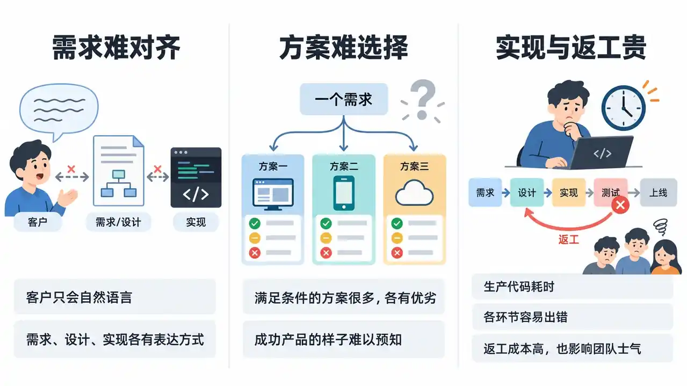
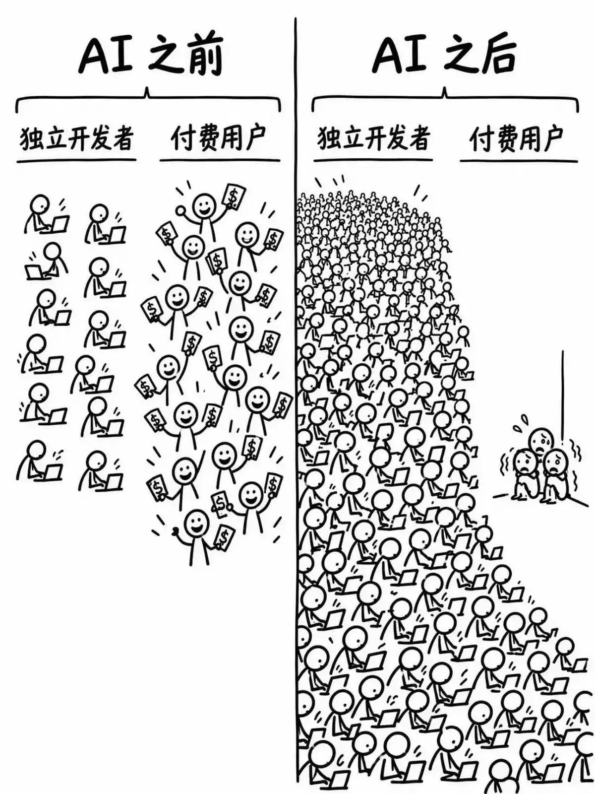
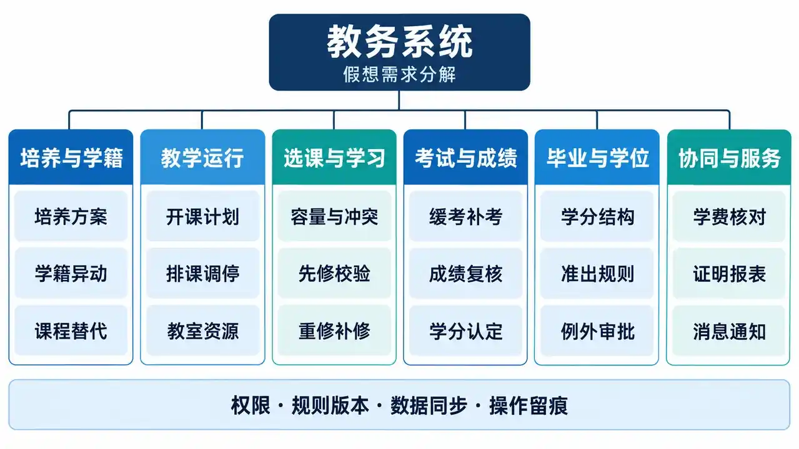
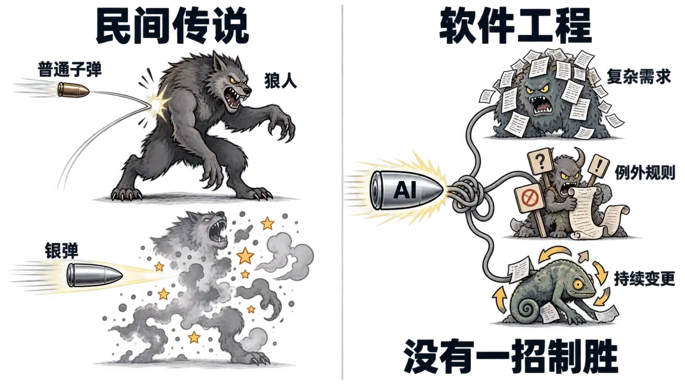
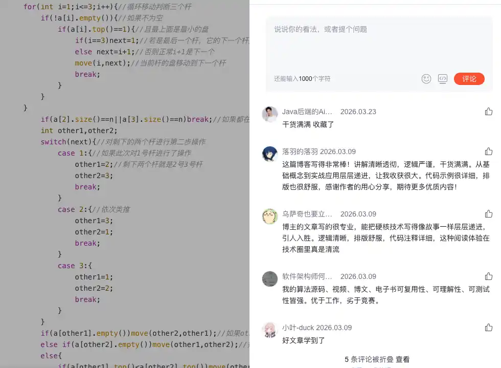
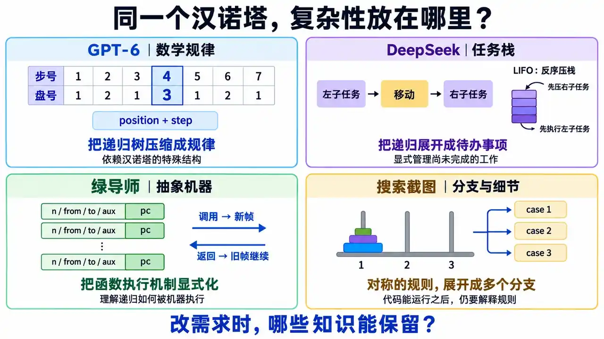
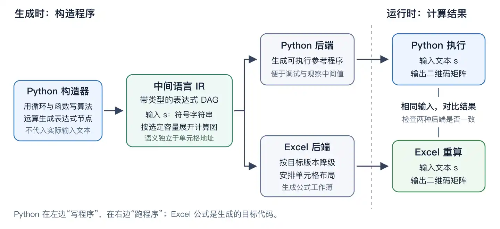
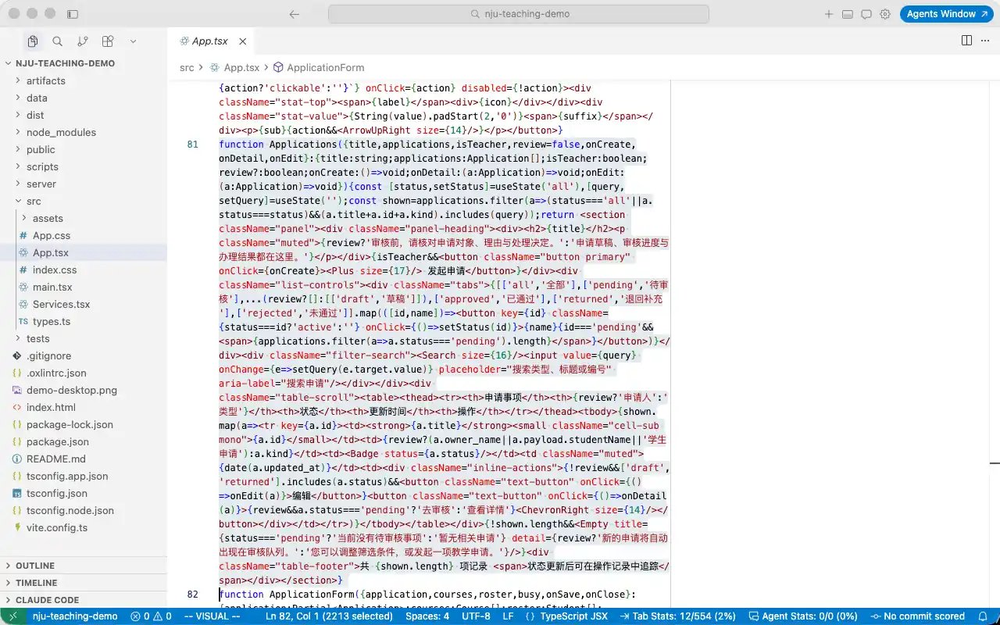
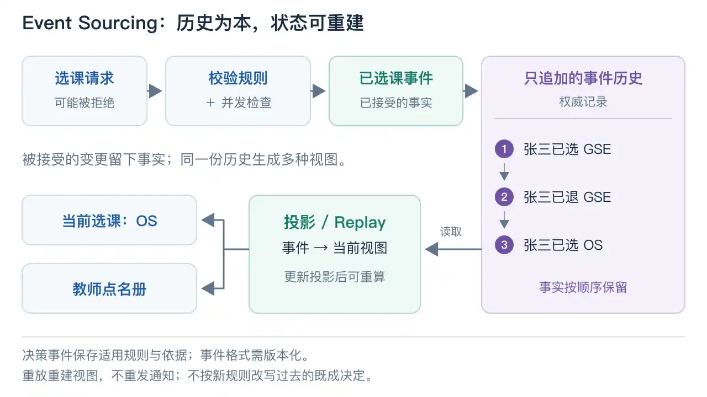
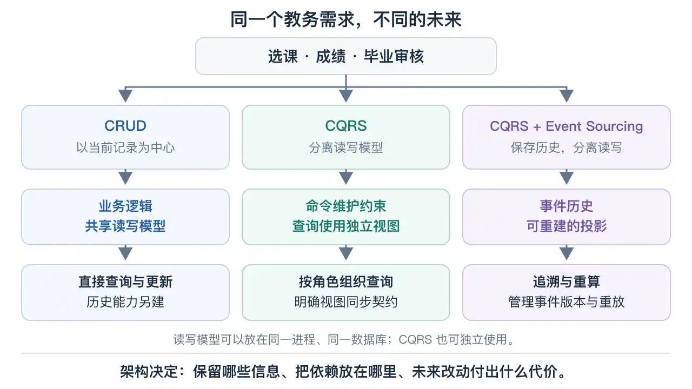

# 第 6 讲 · 需求和架构 (1)

> 来源: https://jyywiki.cn/GSE/2026/slides6.html  
> 共 47 页 · 由 slides6.html 的 slides-data 提取

---

## 第 1 页

# Review & Comments

## 上一讲的三个关键词

  * Intent–Spec–Impl Gap
  * 瀑布模型
  * Data-Dependency Graph

## 各有方法，也需要对齐

  * 需求分析、系统设计、代码实现，各自有方法和工具
  * UML 试图 “对齐” 全世界

## 第 2 页

# “软件工程” 的基本观察：软件不软

## 第 3 页

# 软件工程方法与研究

## 于是有了各种 “软件工程方法”

  * 然而需求、产品、架构都太难**定量研究** 了
    * 所以学校里的 “软工人” 都不在做软工 😁
    * 尤其是什么 “缺陷预测” 这种神奇领域……

## 一个来自城市规划的参照

  * 难的不只是 “怎么测”：不同参与者，可能连 “什么算成功” 都没有共识。参见城市规划中的 [Wicked Problems（Rittel & Webber, 1973）](https://doi.org/10.1007/BF01405730)。

## 第 4 页

# Agentic AI：软件生产力的杠杆

## 生产目标明确的代码，极为便宜

  * 甚至拥有 Agent Swarm 并行的能力
  * Agent 也能写测试用例、断言、甚至是证明

## 需求、产品设计、架构

  * **需求、产品设计、架构** 成为撬动软件生产力的杠杆
    * 如果不认真对待，就会成为 AI Slop 的堆积

## 第 5 页

# 需求工程

## 曾经很难讲：学生不会去见真正的客户，也做不了“需求”级的软件系统 😂

## 第 6 页

# 来看看教务系统吧 😁

## 史诗级的需求爆炸

  * 甚至还有隐藏的 AI 功能
    * 有懂哥告诉我花了多少钱吗？

## 用魔法打败魔法！

  * 让 GPT-6 Astra 先去调研一下教务系统的需求，然后直接实现一个
  * 一个 `/goal`，一小时完成任务

## 第 7 页

# 教务系统：总需求分解，从入学到毕业

## 第 8 页

# 教务系统的需求泥潭

## 按照经典软件工程做产品的思路

  * 把需求方访谈一遍，期末考试都结束了
  * 学生、老师、教务员、教务处、财务、辅导员……各有各自的需求
  * 更糟糕的是：客户**说不清楚** 明确的需求
    * 现实世界的奇葩规则：必修课二选一、准出规则、先修规则……
    * 永远存在的例外：转专业、交换生、缓考、补考、课程替代……

## 说清楚了，也未必能达成一致

  * 学生要选上课，教师要控制班额，教务员要保证毕业：冲突由谁裁决？
  * 城市规划早已遇到这种困境：问题怎样定义，也取决于各方的利益与价值判断。[Rittel & Webber, 1973](https://doi.org/10.1007/BF01405730)

## 第 9 页

# 培养方案：学分够了，就能毕业吗？

## 一个虚构但可能发生的案例

  * 2024 级李同学在 2026 年转入计算机专业，适用目标专业的 2024 版方案。
  * 毕业至少 160 学分：通识 40、专业必修 72、专业选修 28、实践 20，各类分别达标。
  * 数学必修组二选一：高数 A（5 学分），或高数 B（4 学分）＋桥接课（1 学分）。
  * 算法课须先修数据结构；缓考生可暂选，开课前仍未通过则撤销。
  * 两门交换课程获批合抵算法课，认定 4 学分；不能再计入专业选修。
  * 重修学分只计一次，成绩单保留历次记录，绩点按较高成绩算。

## 最后的“暗箱操作”

  * 管理员凭线下审批，点“视为满足”覆盖指定学生的未达标项；记录理由、批准人和适用方案。

## 第 10 页

# 勉强实现需求，然后进入焦油坑

## 经常需要工程师 Hack 数据库

  * 上课第一天：绕过前端校验，把一位同学的缺课次数改为 **−1**
  * 结果：教务系统所有能选出这位同学选课记录的部分**全部瘫痪**

## 第 11 页

# Agentic AI 时代的 MVP

## 有用，且前所未有地容易

  * 优先实现最重要的功能
  * 看到产品，就立即知道哪里做对了、哪里做错了
  * “这门课我已经在交换时修过了。”——让客户试用，也是在发现尚未说出口的需求。
  * Brooks 在《没有银弹》中，也主张用快速原型和迭代澄清需求。[Brooks, 1987](https://cgi.csc.liv.ac.uk/~coopes/comp319/2016/papers/NoSilverBullet-Brooks1987.htm)

## 让你产生“驾驭了 AI”的错觉

  * 那些 dark corners 还没有露出獠牙

## 第 12 页

# There’s No Silver Bullet

## 需求变了，又该如何应对？

  * 需求的变更会穿透整个软件工程的 dependency graph
  * “允许两门交换课程合抵一门必修课”：课程对应、学分统计、毕业审核、成绩单与测试用例都可能要改。

## 随着软件增长，维护成本不断增加

  * 新规则上线，已认定的学分、已批准的特例怎么办？旧决定也成了新需求的约束。

## 第 13 页

# 银弹：传说中的“一招制胜”

## 狼人有克星，软件工程没有万能解法

  * 西方流行传说中，普通子弹奈何不了狼人，银弹却能将其制服；Brooks 用它比喻人们期待的“软件工程万能药”。[Brooks, 1987](https://cgi.csc.liv.ac.uk/~coopes/comp319/2016/papers/NoSilverBullet-Brooks1987.htm)

## 第 14 页

# 软件架构：真正决定软件品味和能走多远的决定性因素

## 驾驭复杂性，应对变化

  * 架构使我们驾驭问题的复杂性
    * 能简化问题、安放复杂性、减少依赖
    * 能应对需求的变化、降低维护成本
  * 甚至再小的代码都有 “架构”

## 把变化安放在边界内

  * 把容易变化的设计决策藏在模块内部，让一次变化尽量只影响一个地方。——[Parnas, 1972](https://ckrybus.com/static/papers/decomposing_systems_into_modules_1972.pdf)

## 第 15 页

# 好的架构：复杂性有归处，变化有边界

## 第 16 页

# 再小的代码也有架构

## 甚至最小的 “状态机” 就是架构
    
    
    int main() {
        read_input();
        parse_input();
        process_input();
        write_output();
    }
    

## 编程语言与架构

  * 你学习的语法、库函数……都可能和架构有千丝万缕的联系
  * 所以我不喜欢老登那种 “语言律师” 的授课方式
    * 语义的价值，是把设计意图变成约束：谁能改数据，谁负责资源，谁可以依赖谁。
    * 回看这四个函数：数据怎样穿过各阶段？换一种输入格式，需要改到哪里？

## 第 17 页

# 10 行的架构例子

## 架构关乎你对需求 “掌控到什么程度”

  * 例子：我喜欢的非递归 Tower of Hanoi
  * 背后的问题：大家到底为什么写不出来？
    * 同一个问题，换一种表示，难度就可能改变：汉诺塔同构变体的实验也观察到了这种差异。([Zhang & Norman, 1994](https://pages.ucsd.edu/~scoulson/203/zhang.pdf))

## 第 18 页

# GPT-6：数学规律

> GPT-6: 反正我不做人类了，你写不出来是因为你数学不如我好 😂

  * 盘号 = 1 + 步号二进制末尾的 0 的个数；每个盘子的移动方向固定。

    
    
    for (uint64_t step = 1; step <= total; step++) {
        int disk = 1;
        for (uint64_t x = step; (x & 1) == 0; x >>= 1) {
            disk++;
        }
        int direction = (n - disk) % 2 == 0 ? -1 : 1;
        int from = position[disk];
        int to = (from + direction + 3) % 3;
        printf("Move disk %d: %c -> %c\n", disk, pegs[from], pegs[to]);
        position[disk] = to;
    }

## 第 19 页

# DeepSeek：任务栈

> DeepSeek: 人类语料里似乎让我这么干
    
    
    push(&s, n, A, B, C);
    while (!isEmpty(&s)) {
        Task t = pop(&s);
        if (t.n == 1) {
            printf("%c -> %c\n", t.src, t.dst);
        } else {
            push(&s, t.n - 1, t.aux, t.src, t.dst);
            push(&s, 1, t.src, t.aux, t.dst);
            push(&s, t.n - 1, t.src, t.dst, t.aux);
        }
    }

## 第 20 页

# 绿导师：抽象机器

> 绿导师：这是理解 C 语言 “形式语义” 的好机会
    
    
    #define call(...) (*(++top) = (Frame){.pc = 0, __VA_ARGS__})
    #define ret() (--top)
    call(n, from, to, aux);
    while (top >= stk) {
        Frame *f = top;
        int next_pc = f->pc + 1, n = f->n, from = f->from, to = f->to, aux = f->aux;
        switch (f->pc) {
            case 0: if (n == 1) { printf("%c -> %c\n", from, to); ret(); } break;
            case 1: call(n - 1, from, aux, to); break;
            case 2: call(1, from, to); break;
            case 3: call(n - 1, aux, to, from); break;
            case 4: ret(); break;
            default: assert(0);
        }
        f->pc = next_pc;
    }

## 第 21 页

## 第 22 页

# 同一个汉诺塔，四种表达

## 复杂性被放在哪里？

  * 选择一种表示，就是选择把哪些事情变得容易。

## 第 23 页

# 2,000 行的架构例子

## 刚才我们展示了“跳出问题看问题”

  * 代码之外有客户的规律
  * 客户之外有社会的规律
  * 社会之外有宇宙的规律

## 这种能力从哪里来？

  * 是你在学校的学习、社会上积累的经验……共同赋予了你这个能力
  * （如果有一天这个能强化学习，就真见证人类完蛋了）

## 第 24 页

# QRCode Generator 的复杂性

## 公式极长且脆弱

  * 直接写公式面临立即崩溃
  * 无数次看到 Agent 和括号不配对搏斗

## 需求变更也极度痛苦

  * 兼容更老版本的 Excel，或允许使用新版本 Excel 的特性
  * 把二维码从一个位置移到另一个位置
  * 改变一种计算方式
  * 增加一个字符串单元格
  * ……

## 第 25 页

# 我们其实要实现的是“编译器”

## 跳出问题看问题

  * 二维码算法容易用伪代码 / 编程语言描述
  * 但它们不能原样变成 Excel 公式
  * 先用**中间语言（IR）** 表达计算规则，再决定怎样落到 Excel 上。

## 用高级语言构造中间语言

  * Python 的函数和循环负责**构造计算图** ；按选定容量展开有限的计算步骤。
  * 字符串输入保留为符号；用户改动单元格后，由 Excel 重新计算二维码。
  * 输入决定的分支写成 `Select(cond, a, b)` 节点，留到运行时判断。

## 第 26 页

# 一份中间语言，两种执行方式

## 构造一次，分别生成

  * 同一个计算图，既能生成便于调试的 Python 程序，也能生成 Excel 公式。

## 第 27 页

# 让需求变更找到自己的位置

## 把可能变化的决策分开

  * 算法只认识 `Input("text")`；输入绑定与布局模块才知道它在 `Input!B2`。

需求变更 | 负责修改的部分  
---|---  
兼容不同版本的 Excel | **目标能力** ：选择可用函数与等价的降级实现。  
把二维码移到另一个位置 | **布局** ：统一分配地址，再解析符号引用。  
改变一种计算方式 | **算法构造 / 优化规则** ：替换对应子图，保持接口语义。  
增加一个字符串单元格 | **输入绑定与组合规则** ：登记新输入，明确拼接、编码和容量。  
  
## 1972 年的架构经验

  * 围绕困难、可能变化的设计决策划分模块，并把这些决策隐藏在接口后面。[Parnas：模块分解的准则](https://ckrybus.com/static/papers/decomposing_systems_into_modules_1972.pdf)

## 第 28 页

# 中间语言要有明确的语义

## 一个可检查的计算图

  * 只实现二维码需要的运算，例如 `Input`、`Const`、`BitXor`、`Lookup`、`Select`。
  * 明确字节范围、整数除法、字符串编码与数组形状；构图时检查类型与容量。
  * 节点保存依赖和来源；生成器统一处理括号与引用，错误能追到“哪一步纠错计算”。

## 两种执行结果，如何验证？

  * 同一输入，比较 Python 与**目标 Excel 实际重算** 后的中间值和输出。
  * 再用独立实现（如 [Nayuki QR Code Generator](https://github.com/nayuki/QR-Code-generator)）或解码器核验，避免两个后端共享同一个算法错误。
  * 逐像素比较前固定版本、纠错等级、分段与掩码；否则比较解码内容。

## 第 29 页

# 性能优化也有自己的位置

## 先优化计算图，再决定中间结果放在哪里

  * **常量折叠** ：固定参数下的定位图案、有限域常量表，在生成时算好。
  * **公共子表达式** ：相同的纯计算在图中共享一个节点，避免反复粘贴成长公式。
  * 公式内复用可用 [`LET`](https://support.microsoft.com/en-us/excel/functions/let-function)；跨公式共享，或目标版本不支持 `LET`，可用辅助单元格。

## 用 Excel 的实际计算成本做选择

  * 按依赖关系安排计算；结合复用次数、计算量和目标版本的公式限制，决定内联还是拆格。
  * Microsoft 也建议拆解巨型公式、减少重复计算、用辅助单元格保存中间结果。[Excel 性能指南](https://learn.microsoft.com/en-us/office/vba/excel/concepts/excel-performance/excel-improving-calculation-performance)
  * 分别测量首次完整计算、修改输入后的重算时间；同时观察工作簿体积，避免把缓存成本藏起来。

## 第 30 页

# 500,000 行教务系统的例子

## 架构：仍然是“跳出问题看问题”

  * 说到“架构”，马上就想到数据库、微服务、流式数据处理……

## AI 来了

  * 不如我们先直接看看现在的教务是怎么实现的？
  * 然后直接让 AI 搓一个 MVP 呢？

## 第 31 页

## 第 32 页

# 新增功能，越来越像拆盲盒

## GPT-6 Astra xhigh 还认为

  * 能维护，但现在是把业务逻辑挤在几个大文件里的演示原型
    * 再不拆分和统一规则，新增功能就会越来越像拆盲盒 😂😂😂

## 第 33 页

# CRUD 架构

## 用“当前状态”描述整个世界

  * 任何时候，系统都存在一个“当前状态”的快照
    * 学生、教师、选课、……
    * 《数据库》课要求你消除表中的冗余 (normal form)，防止不一致
  * 为每个需求点，写一个状态查询/修改的业务逻辑
    * Everything is a state machine 😁 的诱惑

> 架构是一种看待问题的方式。

## 第 34 页

# CRUD 架构的灾难

## “当前状态”里，混着事实、规则和决定

  * “当前状态” = 历史事实 + 当时适用的规则 + 根据规则作出的决定
    * 有大量单点数据是带有 data dependency 的“结果”
    * Data dependency 意味着**前面改了会摧毁后面**
  * 更糟糕的是，这些依赖关系可能没有很好地管理起来 (草台班子嘛)

## 一个“允许毕业”，究竟依赖什么？

  * 课程成绩、课程替代审批、培养方案版本，共同决定学分认定和毕业结论。
    * 成绩更正了：哪些结论要重新审核？哪些已经成为正式决定？
  * 表中没有重复字段，也可能丢掉“这个结论是怎么算出来的”。

## 第 35 页

# 软件是现实过程的有损投影

## 系统外，事情已经发生了

  * 政策更新/领导批准还没有进入教务系统
    * 过了今天这小朋友就不能毕业了 😂
    * 赶紧在系统里 hack 成满足毕业条件
  * 系统中有大量**不一致** 的数据
    * 随着时间变成无法解释的黑洞

## 把“例外”也变成可表达的业务

  * 记录“谁批准了哪项豁免、适用于谁、依据什么”，再由审批产生毕业决定。
  * 只留下 `can_graduate = true`，以后连“特批”还是“算错了”都分不清。

## 第 36 页

# 需求的语义，还会变

## 南大没系啦

  * 例子：[南大没系啦](https://mp.weixin.qq.com/s/ibm6hFMc_JaMOWlqg7RF7A)
    * 计算机系变成了计算机学院
    * 喜大普奔？教务系统瑟瑟发抖
  * `dept_id` 应该用旧的，还是应该开一个新的？
    * “组织的名字”“组织的身份”“当时的隶属关系”，原来是三件事。

## 第 37 页

# 同一个 dept_id，还是新的 dept_id？

## 两个选择，都在承诺一种业务语义

  * **沿用旧 ID、覆盖名称** ：学生、课程、权限关联继续有效；旧报表一 JOIN，历史上的“计算机系”也变成“计算机学院”。
  * **新建 ID** ：旧组织得以保留；不迁关联，新学院像个空壳；全量迁关联，学生和课程过去的归属又被改写。
  * 跨年统计、权限继承、培养方案适用范围，都需要定义旧组织与新组织的关系。

## 先判断身份是否延续，再给变化建模

  * 如果业务认定**组织身份延续** ：保留稳定 `org_id`，名称、层级、隶属关系按**有效期** 保存版本。
  * 如果业务认定**产生了新组织** ：建立新 ID，记录带日期的承继关系；学生、课程按业务决定转移，保留原归属。
  * 查询明确选择“当时归属”或“按今天口径汇总”；培养方案单独绑定版本，不能让新名称自动触发新规则。

## 第 38 页

# 系统一旦跑起来，修改的代价极高

## 代码可以重写，历史不能凭空补出来

  * 数据库迁移、业务逻辑重写都是风险极高的操作
    * 不一致的数据无法解释
    * 同样一个“已毕业”，可能来自正常审核、人工特批，也可能只是某次救火。
  * 软件的设计、实现、维护都是手艺活
    * 这也是 ERP 类系统的护城河
  * 迁移需要决定哪些历史含义继续成立；没有保存的依据，AI 也推不回来。

## 第 39 页

# 把依赖变成 First-Class Citizens

> 如果我们跳出问题看问题：既然都知道 dependency 是问题，为什么不能直接把它们变成 first-class citizens？

## 数据结构的两面：当前状态与操作历史

  * 数据结构可以记录“当前状态”，也可以记录“操作历史”
    * 张三选修了《生成式软件工程》
  * 状态由 replay 事件序列决定 (语义 = 状态机)
    * 这样，我们就有底气面对语义改变了
    * 当然，还有很多问题要小心处理，比如语义的版本
  * 祝贺，你发明了 [event sourcing](https://martinfowler.com/eaaDev/EventSourcing.html)
  * 账本的直觉：余额是结果，逐笔记录让我们知道结果从何而来。

## 第 40 页

# Event Sourcing：从事件历史生成状态

按顺序应用已经接受的事实；新事件增量更新，历史事件支持重建。参见 [Event Sourcing](https://learn.microsoft.com/en-us/azure/architecture/patterns/event-sourcing)。

## 第 41 页

# Replay 时，究竟重放什么？

## 恢复历史，与按新规则重新计算

  * **恢复历史** ：还原当时记录的事实和决定；解释决定还需要当时的规则版本与输入依据。
    * “当年已授予学位”是已发生的事实，不能因今天重算不通过就消失。
  * **重新计算** ：在新投影中回答“按新方案会怎样”；若要改变正式结论，再走审核并记录新决定。

## 让历史真正可解释、可重放

  * 给事件格式和业务规则分别管理版本；保留影响决定的外部输入。[版本演进](https://learn.microsoft.com/en-us/azure/architecture/patterns/event-sourcing)
  * 事实录错了，追加更正及原因；重放时隔离通知、扣费等副作用。[重放与外部系统](https://martinfowler.com/eaaDev/EventSourcing.html)
  * 事件序列保留了变化；**谁依赖谁** ，还要在事件和决定中显式记录。

## 第 42 页

# CQRS：读与写，可以有不同的模型

## Command Query Responsibility Segregation

  * **Command（写）** ：表达业务意图，如“申请选课”；检查资格、容量、冲突，然后接受或拒绝。
  * **Query（读）** ：按使用者组织信息，如学生课表、教师点名册、教务统计。
  * 读模型可以针对查询做冗余和预计算，写模型集中维护约束。[CQRS](https://martinfowler.com/bliki/CQRS.html)

## 分开之后，要约定如何同步

  * 如果异步更新视图：选课已确认，但课表还没刷新，界面应能解释这个间隙。
  * 读写模型可以共享进程和数据库；是否使用 Event Sourcing，是另一项选择。[实现方式](https://learn.microsoft.com/en-us/azure/architecture/patterns/cqrs)
  * Pre-LLM 时代就有这些实践：我们开始分别设计“怎样做决定”和“怎样看结果”。

## 第 43 页

# DDD：让业务概念决定软件边界

## Domain-Driven Design

  * 开发者与教务人员共同建立业务模型，让“选课”“学分认定”“毕业审批”成为代码中的概念。
  * **统一语言** ：在一个明确边界内，同一个词具有一致含义。[领域模型与语言](https://martinfowler.com/bliki/BoundedContext.html)

## “学生”并不只有一种模型

  * 选课关心资格与名额；财务关心应收与到账；毕业审核关心认定学分与适用方案。
  * 建立**限界上下文** ：各自维护自己的模型，通过明确的接口和含义对接。
    * “课程成绩已通过”传给学分认定；能否计入本专业学分，由学分认定的规则决定。
  * DDD 安排业务语义和边界；CQRS 分开读写模型；Event Sourcing 选择如何保存历史。三者可以组合。

## 第 44 页

# 实践：让一个结论带着它的依据

## 规则与依赖，也成为数据

  * 一次毕业审核记录：**输入记录 ID 与版本（或快照）+ 规则版本 + 结论 + 审批依据** 。
    * 成绩更正后，沿依赖关系找到受影响的审核；已发布的决定进入复核流程。
  * 规则独立版本化：同一批事实可以计算候选方案，并列比较差异。

## 现实发生的时间，系统知道的时间

  * 例：豁免 6 月 1 日生效，6 月 3 日才录入；这两个时间都要保留。
  * 因此能分别回答“6 月 2 日豁免是否已生效”和“6 月 2 日系统为何拒绝毕业”。[双时态历史](https://martinfowler.com/articles/bitemporal-history.html)
  * 这是依赖、决策与时间的建模；事件表之外，还要显式记录[结果对输入的依赖](https://arxiv.org/abs/0708.2173)。

## 第 45 页

# 实践：先决定什么必须一起正确

## 用业务不变量划定一致性边界

  * 最后一个名额，两人同时申请：**检查容量与确认占位必须原子地完成** 。
    * 事件存储也要检查并发版本；冲突后重新加载、重新判断。[并发控制](https://learn.microsoft.com/en-us/azure/architecture/patterns/event-sourcing)
  * 课表、点名册若允许稍后更新，应标明数据更新时间；“选课成功”由写端完成资格检查与占位后确认。

## 把最容易变化的决定关在边界里

  * 培养方案、课程替代、身份映射各有负责模块；调用方依赖明确契约。
  * 可以先做模块化单体，把数据归属和模块接口理清，再按独立发布、扩容需求拆服务。
  * 信息隐藏的关键是隔离会变化的设计决定。[Parnas, 1972](https://www.cs.lafayette.edu/~gexia/cs301/resources/parnas.html)

## 第 46 页

# 实践：让运行中的系统逐步换轨

## 从一条业务链开始积累可解释的历史

  * 先选择“毕业审核”：明确事实来源、规则版本和审批流程，逐步接管其写入入口。
  * 旧系统提供切换时的基线快照，明确它的时间与来源；缺失的历史不伪造成事件。
  * 一条业务写入只认一个权威来源；其他视图可以由记录的变化重建。

## 用真实案例验证，再扩大边界

  * 新旧审核并行对账：重点解释转专业、补考、课程替代、人工豁免的差异。
  * 逐步切换功能，保留故障回退安排；这是 [Strangler Fig](https://martinfowler.com/bliki/StranglerFigApplication.html) 式迁移的思路。
  * 把追溯与重算用在需要它的业务；教室信息等简单维护仍可采用 CRUD。

## 第 47 页

# 几个字的架构，改变整个系统的走向

