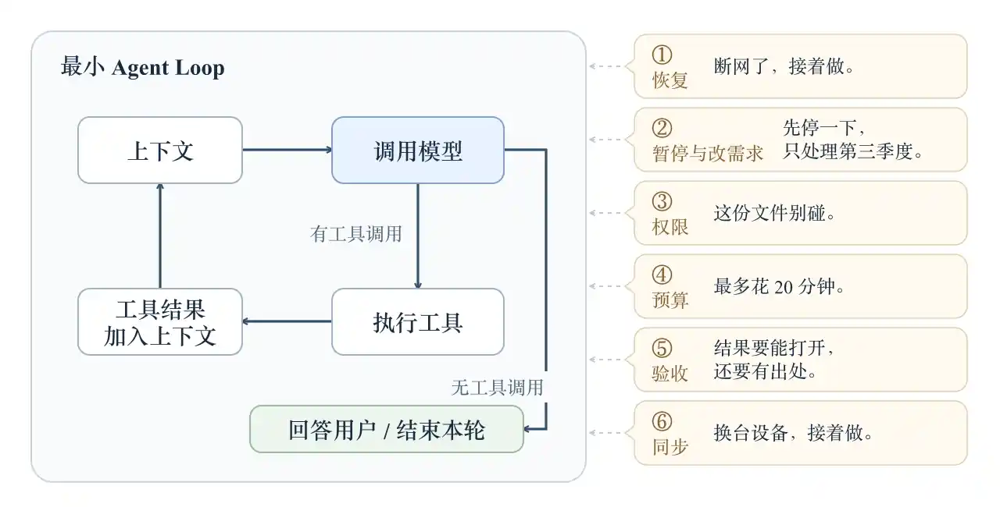
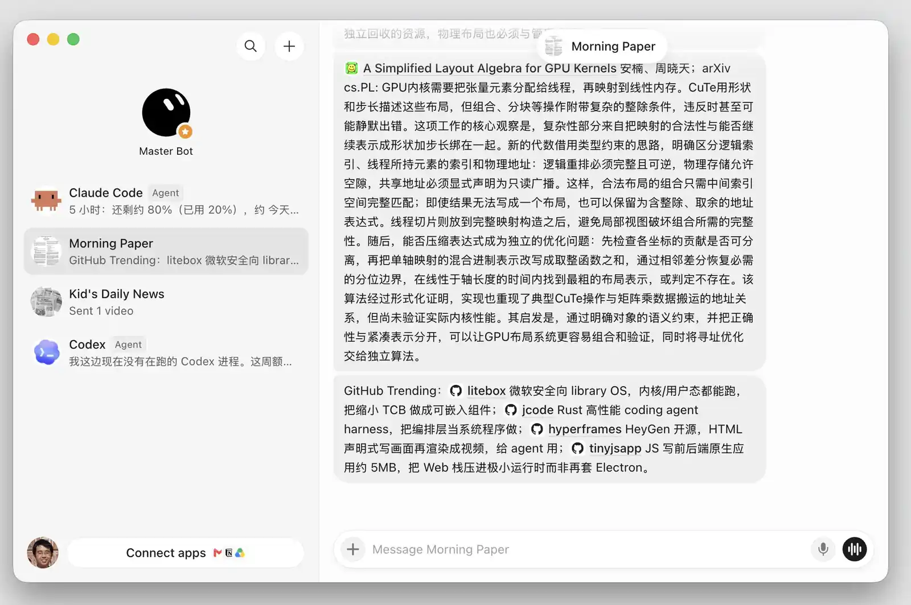
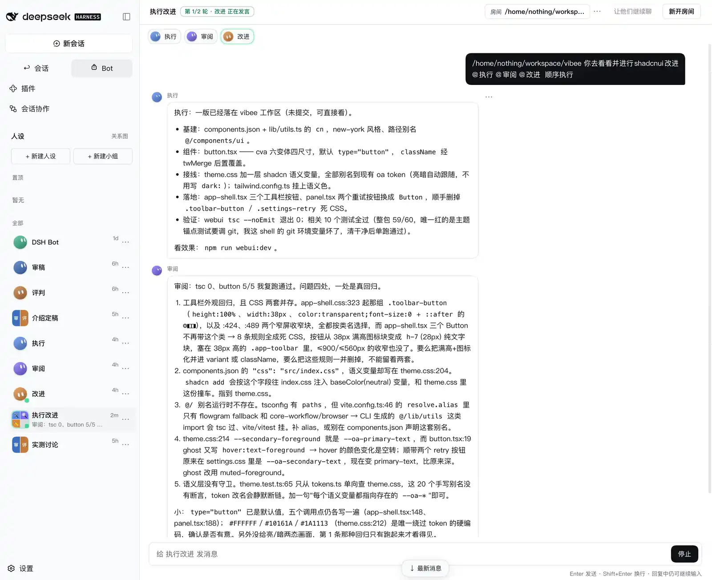
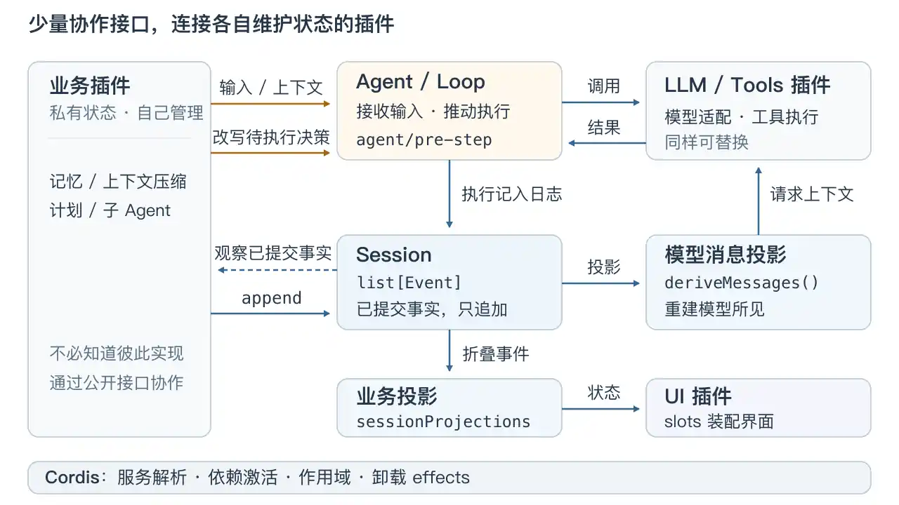

# 第 9 讲 · DeepSeek Harness

> 来源: https://jyywiki.cn/GSE/2026/slides9.html  
> 共 30 页 · 由 slides9.html 的 slides-data 提取

---

## 第 1 页

# Review & Comments

## 软件工程

  * Intent、spec、impl 之间的 gap
  * [Mars Climate Orbiter (1999)](https://llis.nasa.gov/lesson/641)：接口规格已规定公制，交付的数据仍是英制。

## 项目管理

  * Git, Jujutsu, ...

## 第 2 页

# Review & Comments

## 需求和架构

  * 不可避免的 essential complexity 和 accidental complexity
  * 各种弥补 gap 的实践范式、方法、工具……
  * [Brooks (1986)](https://worrydream.com/refs/Brooks_1986_-_No_Silver_Bullet.pdf)：若花在 accidental complexity 上的工作不到九成，即使全部消除，也换不来十倍提升。

## Agent-Native 开发

  * 开发状态管理
  * CI/CD

## 第 3 页

## 第 4 页

# Agent Harness: 需求

## 上节课：150 行的 Mini-Agent

  * 它**完全可以工作**
    * > 生成一个相对真实的南大仙林校区3D图。

    * 让我们看看 one-shot 直出的结果

## 不，它不能

  * 上一个版本假设了网络／服务不会中断，结果直接断了
  * 这就是 **essential complexity** （来自需求）
    * 如果 API 中断，应该怎么办？

## 第 5 页

# API 中断，应该怎么办？

## 先弄清楚发生了什么

  * 暂时断网、服务限流：保留进度，有限重试。
  * 输入损坏、权限不足：需要改变条件，原样重试没有用。
  * 执行结果未知：**没收到结果，不等于没有执行。**

## “接着做”会不会变成“再做一遍”？

  * 例如：文件已经移动，但工具结果还没来得及记录，进程就崩了。
    * 恢复后先核实实际状态；不能直接重放有副作用的操作。
  * [AWS 的重试设计经验](https://aws.amazon.com/builders-library/making-retries-safe-with-idempotent-APIs/)：可靠性不只是“失败后再试一次”，还包括“不多做一次”。

## 第 6 页

# 需求可太多了

## 围绕 Agent 的能力

  * 项目、工具、Skills、沙箱和权限……
  * 上下文压缩、记忆、索引……
  * 用户交互、文件编辑……
  * 远程访问、App 同步、备份和恢复……

## [办公 Agent 产品需求规格说明书](embedded/slides9-办公 Agent 产品需求规格说明书.md)

  * 执行控制：排队、暂停／停止、中途改要求、预算与用量。
  * 交付与验收：可编辑产物、版本、来源、检查、部分完成。
  * 隐私与诊断：账号隔离、外部指令隔离、数据外发、脱敏反馈。
  * 使用体验：响应与停止时限、平台与格式兼容、键盘可访问性。

## 第 7 页

# 一个小循环，被真实世界包围

## 第 8 页

# Agent Harness: 需求的改变

## Grok Bot 火了

  * 之前的需求全崩了 😂

## 第 9 页

# Agent Harness: 需求的改变

  * 大厂开始疯狂拉通对齐闭环沉淀复用 v.s. [dsh-bot](https://github.com/Nothing1024/dsh-bot) 秒发

## 第 10 页

# 回到 2026 年 6 月 10 日 22:57

## 主流产品

  * Claude Code, OpenCode, Trae, CodeBuddy, ...

## 一个神秘的项目启动了

  * Initialize repo with README, AGENTS.md, and CLAUDE.md symlink
  * Link MVP requirement analysis and microkernel architecture docs in AGENTS.md

## 第 11 页

# 架构：没有免费的午餐

架构是 “受限” 和 “自由” 之间的平衡。

## “在架构下” 意味着牺牲了什么？

  * 操作系统上的进程：不能任意控制硬件、访问其他进程的内存
  * 高级语言程序：接受语言的表达规则，把部分控制权交给编译器和运行时
  * LAMP (Linux, Apache, MySQL, PHP)：把业务放进 Web 请求、应用逻辑、关系数据库的分工
  * Event sourcing：不能随意覆写状态，变更必须通过记录事件表达

## 得到了什么？

  * 干净、解耦合、容易理解和维护的代码——前提是边界划分与需求吻合
  * 复用框架带来的基础设施工具 (测试、日志……)
  * 共同的接口和约定：团队可以分别开发，模块可以替换
  * 把一类问题交给基础设施统一解决：隔离、优化、恢复，不必每个业务重写一遍

## 第 12 页

# 架构的假设，也有有效期

架构与需求吻合时，就是便利；假设改变时，抽象开始泄漏，架构就成为阻力。

## 社会不断打破旧假设

  * 人类社会的进步导致旧系统做出的假设不断被打破
  * 新产业诞生，旧产业消亡
  * 人才的流转、阶级的流动

## 电力改变的不只是动力源

  * 蒸汽工厂：机器布局受传动轴、皮带约束；独立电机让设备可以按生产流程重新排列。[David, 1990](https://gwern.net/doc/economics/automation/1990-david.pdf)
  * 沿用旧厂房布局，也能用上电；重组设备与生产流程，才能进一步兑现新技术的收益。
  * 旧假设会固化在厂房、岗位、流程和投资里；技术已经变了，组织可能还在围着“传动轴”转。

## 第 13 页

# AI：产业的超级加速器

## 已经观察到的变化

  * 一项覆盖 5,172 名客服人员的研究：AI 辅助使每小时解决的问题数平均提高 15%，收益因经验而异。[QJE, 2025](https://academic.oup.com/qje/article/140/2/889/7990658)
  * 任务的成本与技能门槛正在改变；从一个任务的提效，到整个产业的重组，中间还有组织与流程。

## 推演：当搜索、表达、试错变便宜

  * 过去不划算的小需求变得值得满足：给一个班写工具、给一种设备做定制界面，供给和需求一起扩张。
  * 实现更快，需求也更快改变：“需求稳定、开发昂贵”的旧假设开始松动，固定流程可能成为新的等待点。
  * 瓶颈可能移向验收、信任与物理执行：方案能批量生成，谁来判断对不对，谁来把它做出来？
  * 新人更容易跨过部分技能门槛；掌握数据、客户和分发渠道的人也可能扩大优势。产业、人才与阶层会重新流动，收益如何分配仍取决于组织和制度。

## 第 14 页

# 操作系统：进程的自由有边界

## 接受隔离，获得“自己的机器”

  * 约束：在自己的地址空间里执行，通过系统调用申请资源；不能想改谁的内存就改谁的。
  * 便利：编辑器、编译器和播放器同时运行；一个进程的非法访存可以被终止，而不直接改坏另一个进程的地址空间。

## 当“内存够用”的假设被打破

  * 程序逻辑没变，活跃数据却放不进物理内存；启用交换时，频繁换页可能让机器忙于搬数据。[工作集与抖动](https://denninginstitute.com/pjd/PUBS/Workingsets.html)
  * 本机能跑的程序，放进有限额的运行环境却被杀掉：Linux 的 `memory.max` 达到上限且无法回收时，会触发组内 OOM。[内核文档](https://docs.kernel.org/admin-guide/cgroup-v2.html)
  * 独立地址空间隐藏了地址映射，物理资源的容量和竞争仍会进入程序的性能与可靠性。

## 第 15 页

# 高级语言：内存管理交出去之后

## 以 Java 等托管语言为例

  * 约束：按语言的对象、类型与引用规则写程序；对象布局和回收时机主要交给运行时。
  * 便利：实现课程论坛时，专注帖子、评论和业务规则，不必逐个决定对象何时 `free`。

## 从“算得对”到“必须及时响应”

  * 论坛加入实时互动：突然大量创建短命对象，GC 的暂停与 CPU 开销可能进入用户可感知的延迟。
  * 降低暂停、提高吞吐、减少内存占用，是需要权衡的目标；调一个参数不能保证同时改善三者。[HotSpot GC 调优](https://docs.oracle.com/en/java/javase/25/gctuning/ergonomics.html)
  * 业务代码仍然正确，却要重新理解分配速率、活跃对象和堆大小——运行时隐藏的成本又回到了开发者面前。

## 第 16 页

# LAMP：从表单网站到在线协作

## 请求、业务、数据，各司其职

  * 约束：典型表单网站把一次操作组织成“HTTP 请求 → PHP 处理 → MySQL 读写 → 返回页面”。
  * 便利：课程报名的名额检查和报名记录可放进同一数据库事务；Web 服务、持久化与备份都有现成基础设施。

## 请求要结束，协作却要一直在线

  * 新增课堂实时讨论：若用 PHP-FPM 请求一直等待消息，工作进程就一直被占用；并发上限由进程池容量约束。[PHP-FPM 文档](https://www.php.net/manual/en/install.fpm.configuration.php)
  * 可以接入 WebSocket 与消息广播，但要重新安排连接、共享状态和后台任务；Apache 本身已有 WebSocket 代理支持。[Apache 文档](https://httpd.apache.org/docs/2.4/mod/mod_proxy_wstunnel.html)
  * 再加入外部支付：数据库回滚不能自动撤销已完成的扣款。重试、去重和补偿需要业务自己定义，单库事务的边界显现出来。

## 第 17 页

# Event Sourcing：能回放什么？

## 接受事件历史，获得审计与重建

  * 约束：把已发生的事实作为记录，状态由事件推导；纠错也要说明发生了什么。
  * 例如校园卡：`充值 100 → 消费 12 → 退款 12`，既能计算余额，也能回答“为什么是这个数”。
  * 便利：从同一份历史重建余额、生成流水、查询过去状态。[Event Sourcing](https://martinfowler.com/eaaDev/EventSourcing.html)

## “重新计算”遇上现实世界

  * 重算余额可以，回放事件时再扣一次钱就错了；外部调用必须区分真实执行与历史回放。[外部副作用](https://martinfowler.com/eaaDev/EventSourcing.html#ExternalUpdates)
  * 历史外币消费不能按今天的汇率重算；需要保存当时的输入，并处理规则、事件格式的版本变化。[外部查询与代码变化](https://martinfowler.com/eaaDev/EventSourcing.html#ExternalQueries)
  * 事件保存了历史事实；重现当时的结果，还依赖解释这些事实所需的上下文。

## 第 18 页

# MapReduce：接受计算形式，换取集群能力

## 案例：[MapReduce](https://usenix.org/legacy/events/osdi04/tech/full_papers/dean/dean_html/index.html)

  * MapReduce 要求把计算组织成 `map → 按 key 分组 → reduce`
  * 接受这个形式，就能获得自动并行、任务调度、负载均衡、失败重试
  * 例如统计网站访问量：每条日志输出 `(URL, 1)`，按 URL 分组求和；某台机器坏了，就重新执行它的任务。

## 哪些细节仍要自己处理？

  * 热门 key：大量数据汇聚到同一个 reduce 调用，自动调度无法替你拆开任意的归约逻辑；可能需要预聚合或重新设计 key。
  * 外部副作用：若 map 顺手发邮件，重试可能重复发送。原论文 §4.5 就要求应用作者保证额外副作用的原子性与幂等性。
  * “失败就重算”的便利，建立在重新执行仍能得到正确结果的约束上。

## 第 19 页

# 当计算不再是一轮批处理

## Spark：迭代计算需要复用数据

  * 批处理不够灵活：Spark 用更一般的计算 DAG 组织多阶段处理，缓存可复用的数据集。
  * 例如反复迭代同一批训练数据：不用每轮都经外部存储交换结果；分区丢失时按依赖关系重算。[RDD 论文](https://www.usenix.org/conference/nsdi12/technical-sessions/presentation/zaharia)
  * 新的取舍：哪些数据缓存、如何分区、内存不足时怎么办，又成为性能问题。[RDD 缓存](https://spark.apache.org/docs/latest/rdd-programming-guide.html#rdd-persistence)

## Flink：实时需求不能等数据全部到齐

  * 传统批处理难以满足低延迟实时需求：Flink 让算子持续处理到达的数据，并维护状态。
  * 例如“最近五分钟的访问量”：日志会乱序、迟到；事件时间、水位线和迟到处理策略一起定义什么时候产出或修正结果。[时间与水位线](https://nightlies.apache.org/flink/flink-docs-stable/docs/concepts/time/)
  * 技术栈也随之重组：输入可来自 Kafka 等可重放日志；执行变成常驻算子；恢复要协调输入位置与算子状态的检查点。[有状态流处理](https://nightlies.apache.org/flink/flink-docs-stable/docs/concepts/stateful-stream-processing/)
  * “等多久算完整”“保留多少状态”成为新的架构约束，性能与结果语义一起进入设计。

## 第 20 页

# 设计 Agent Harness: First Principle

## Everything Is a Plugin

  * 彻底解耦合：每个 plugin 都有私有的状态
  * 但我不讲 Cordis（虽然这也是架构的一部分 😂）
    * 服务解析、依赖激活、作用域、卸载
    * 就跟操作系统提供了进程生命周期和访问控制一样

## 真正的难点是协同

  * 不协同 = 没用
  * 随便协同 = 没法用

## 第 21 页

# 构建 Agent Harness 的“世界模型”

## 操作系统有进程、文件、网络

  * `Session = list[Event]`
    * 模型上下文、业务状态……都是 Session state 的投影
    * 这不就是 **Event Sourcing** 吗
    * 一个历史类比：Pacioli（1494）记述的日记账 → 分类账，把同一笔交易按账户组织。[历史账簿](https://exhibits.lib.ku.edu/exhibits/show/keeping-the-books--the-rubinst/under-the-tuscan-sum---the-ita)

## 再加上执行与交互

  * Agent 接收输入、推动执行
  * 用于装配 UI 的 slots

## 第 22 页

# Session: 从事实到投影

## 1\. 记录与观察事实

  * 插件记录自己负责的业务事件，观察已经提交的事实

    
    
    session.append(type, data)
    ctx.on('session/event', (session, event) => { ... })
    

## 2\. 从事实生成投影

  * 模型消息历史、业务状态……都是同一个 Session 的投影

    
    
    session.deriveMessages() // 模型消息历史
    ctx.sessionProjections.register(definition)
    ctx.sessionProjections.stateOf(session, key) // 读取业务投影

## 第 23 页

# Agent: 接收输入与动态上下文

## 3\. 向 Agent 提交输入

  * `followup`：新的一轮用户输入，唤醒执行
  * `inject`：补充上下文，等待后续 step，不唤醒
  * `steer`：尽快进入后续 step，可以唤醒

    
    
    agent.followup(message)
    agent.inject(message)
    agent.steer(message)
    

## 4\. 持续贡献动态上下文

  * `text` 动态读取当前状态

    
    
    ctx.systemPrompt.context({ ..., text: () => describeCurrentState() })

## 第 24 页

# Hooks: 参与执行决策

## 5\. 在执行前介入

  * 插件能 hook（改写）pending 决策

    
    
    ctx.on('agent/pre-step', async (payload, next) => {
      const decision = await next()
      return decision
    })
    

## 已经发生的事实，与尚未执行的决策

  * `session/event`：观察已提交的事实；要补充或纠正，追加新事件。
  * `agent/pre-step`：参与待执行的决策；调用 `next()` 才会委托后续处理链。

## 第 25 页

# 插件挂在“总线”上

## 第 26 页

# 一切都是为了插件生态

## TUI

  * 不管任何 slot，直接调用 session / agent API

## pdf-reader

  * `inject = ['tools']`
  * 生命周期由 Cordis 管理

## dsh-better-sidebar

  * 把整个 Session 投射成 VS Code 的样子

## 那为什么不许愿插件呢？

  * 恭喜，你发明了 **Creator Mode** (Agent 可以直接热插拔插件)

## 第 27 页

# 那么，代价呢？

## 生态碎片：插件之间的语义冲突，得自己管理

  * A 改写输入，B 检查输入；先后顺序可能改变结果
  * 两个 Hook 都合法，但一个要求继续，另一个要求停止
    * 电话系统也如此：“遇忙转移”遇上“呼叫等待”，新来电该转走，还是留下？[Feature Interaction](https://www.sciencedirect.com/science/article/abs/pii/S1389128613001527)
  * 插件开始依赖另一个插件产生的事件、注册顺序或副作用

## 10 个自动上下文压缩插件

  * 每个都压缩 $1/2$，最后被压缩到没法用 😂

$$ \left(\frac{1}{2}\right)^{10} = \frac{1}{1024} $$

  * 即使顺序不影响结果，“每个插件单独合理”也不保证“组合起来合理”。

## 第 28 页

# 维护和生态

## DeepSeek Harness 的好处

  * 接口简单，复杂性低，可以**随便 vibe**
  * 说什么就 vibe 什么
    * 所以其实我觉得 dsh 的开源社区走远了

## 把试错留在用户现场

  * [用户创新工具包](https://web.mit.edu/people/evhippel/papers/Toolkits%20JPIM%20final.pdf)（von Hippel，2001）：把依赖具体需求的设计交给用户，减少反复转述需求的成本。

## 第 29 页

# 方向一：大型 App 的 AI 增强

## 一个非常小的抽象层

  * 对现有应用只需接入一个非常小的抽象层
    * lock objects + serialize objects + UI
  * 还要什么 WorkBuddy?

## 复用现有应用的能力

  * [VBA](https://learn.microsoft.com/en-us/office/vba/library-reference/concepts/getting-started-with-vba-in-office/) 已让 Office 的功能可以通过对象编程；现在，模型可以根据意图临时组合这些能力。

## 第 30 页

# 方向二：GenUI

## 建立 Session（卡片）和模型的双向通道

  * 允许模型输出一个 HTML + JS 卡片
  * 允许卡片里的代码注入信息到上下文中

## 我甚至可以和 DeepSeek 下棋了 😁

  * 点棋盘落子 → 棋局写入上下文 → 模型应手 → 卡片更新。
  * 把[直接操纵](https://www.cs.umd.edu/~ben/papers/Shneiderman1983Direct.pdf)接进对话：用点击精确表达动作，用自然语言表达意图。

