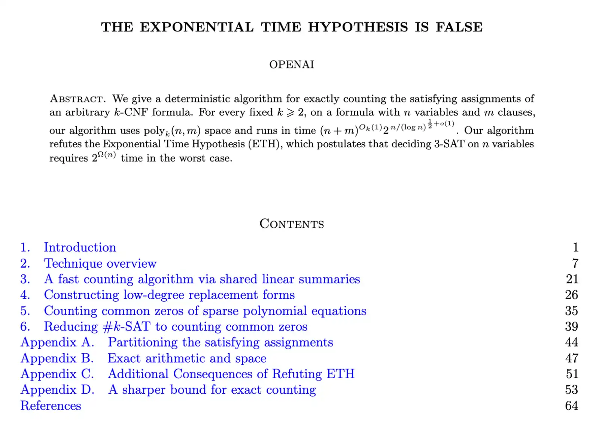
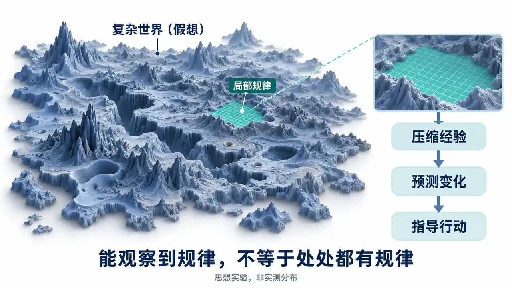
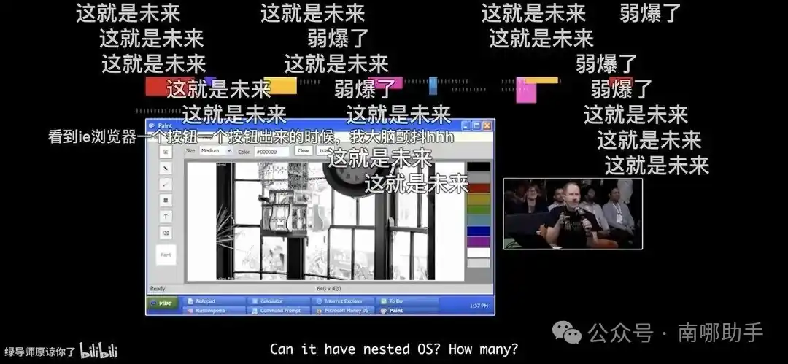
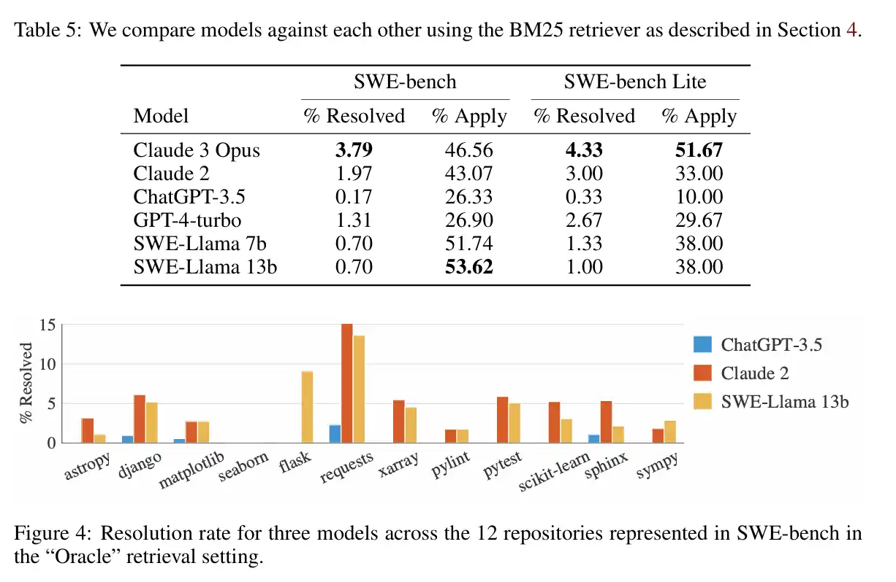

# 第 10 讲 · 软件的演化

> 来源: https://jyywiki.cn/GSE/2026/slides10.html  
> 共 23 页 · 由 slides10.html 的 slides-data 提取

---

## 第 1 页

# 日常震惊瘫坐

## 第 2 页

# 人类工具的边界

## 优美的对称也许只是一种幻觉

  * 人类的工具 (大脑、程序、……) 在科学发现上面临**失效**
  * PTIME 是为了 reduction closure 等性质，人用着方便下的定义，藏着各种能卡人的 bug
    * $P$ 把 $n^2$ 与 $n^{100}$ 放进了同一个抽屉。

## 更“难”的问题结构，我们理解得了吗？

  * 比如：给定计算模型，$k$ 步之内到底能算出哪些 problem classes？
  * 于是只能跑去做更“干净”的问题，例如生物[分类学](https://ptree.org/#GBIF/)

## 第 3 页

# 我们刚好站在“平坦”的地方？

## 实际世界的结构可能是很差的，只是我们刚好在“平坦”的区域里

## 第 4 页

# 压缩、预测与智能

## 一个关于观察者的猜想

  * 也许只有对称的区域，才能通过压缩的方式产生智能
    * 对称是一种可复用的结构；可压缩的结构未必都长得对称。
  * 由此推想：我们能成为观察者，本身就可能筛掉了那些无法积累经验的环境。

## 描述得出，不等于驾驭得了

  * [Lorenz (1963)](https://journals.ametsoc.org/view/journals/atsc/20/2/1520-0469_1963_020_0130_dnf_2_0_co_2.xml)：三条微分方程就能定义系统，微小初态误差却会放大——规律很短，长期预测仍可能失效。
  * 另一种可能：AI 找到了可压缩的结构，只是它超出了人类惯用的表示方式。

## 第 5 页

# 最近的暴论：教育循环正在松动

## 家庭投资教育，大学培养人才，企业购买劳动

  * 这个循环面临失效
  * 大学既帮人获得能力，也帮企业识别能力；后者对应 [Spence 的教育信号理论](https://competitionandappropriation.econ.ucla.edu/wp-content/uploads/sites/95/2017/08/Spence1973.pdf)。

## AI 可能同时改变这两件事

  * 能力的价格：花几年练出来的本领，可能变成人人可调用的服务。
  * 能力的证明：一份漂亮成品，越来越难说明其中有多少是人的贡献。

## 第 6 页

# 用 AI Trajectory 证明自己

## 教大家一个当下证明自己的方法

  * 用 AI trajectory 多维度地评价自己的能力、成长力、创造力……
    * 看你何时不接受 AI，以及拿什么证据改变判断。
    * 再看同类问题第二次出现时，你是否作出了更好的选择。

## 英雄所见略同

  * 不需要沟通，两个人的 AI trajectory 就能知道是否“英雄所见略同”
  * 甚至可以用来匹配交友 😁

## 第 7 页

# 上学也是一笔面向未来的投资

## 上学本身已经是“期货投资”了

  * 今天投入学费、时间和放弃的工作收入，押注几年后的技能需求。[人力资本投资](https://www.journals.uchicago.edu/doi/abs/10.1086/258724)
  * 选专业时下注，毕业时由就业市场给技能定价；没有企业预先承诺收购。

## “贷款上班”的时代要来了吗？

  * 能证明你比 AI 很强，留下；否则就交罚款
    * 沿着这个暴论推下去：为了继续卖出劳动，先自费购买下一轮训练。
    * 当技能贬值，再训练的成本与岗位消失的风险，最后由谁承担？
  * 也许真的需要 AI 不扩散条约了……😂

## 第 8 页

# Review & Comments

## DeepSeek Harness: 一个 “操作系统”

  * 是个航母
    * 飞机还处于试验阶段
    * 航母战斗群的概念还没有建立
    * 1922 年的 [USS Langley](https://www.history.navy.mil/browse-by-topic/ships/aircraft-carriers/uss-langley.html) 是舰载航空的试验平台；它的起降经验传给了后来的航母。
  * 期待生态的未来
    * 也许成功的未必是 dsh
    * 但围绕 Agent 的**生态** 是未来

## 第 9 页

# USS Midway (San Diego)

[真正航母的故事](/GSE/2026/p10/ships.html)：如此复杂的系统，是如何在 1945 年造出来的？

## 第 10 页

# 从航母到软件

## 我们也在造航母了：[欢迎加入](https://mp.weixin.qq.com/s/Mlvdtd2LuMTEYxP5P7NPCg)

  * 只有全栈 (包括我；和 LUG 里每天水群的同学)；后续会扩大，提前收简历 😁

## 第 11 页

# 软件的 “时间维度”

## 早期，通常只是一个精简的 Idea

  * 引入不必要的架构复杂性，可能反而**约束** 了未来的走向
    * 随着 essential complexity 的增加，很多架构经受住了时间的考验，但也有不少部分被重构

## 给未来留下什么？

  * 每个提前设计的扩展点，都包含一个假设：“未来会沿着这个方向变化。”
  * [Parnas (1972)](https://www.cs.lafayette.edu/~gexia/cs301/resources/parnas.html)：按可能变化的设计决定划分模块，把这些决定隐藏在边界后面。
    * 架构要给尚未发生的变化留下修改空间。

## 第 12 页

# 演化：哪些东西容易换？

## Linux：调度算法可以被替换

  * O(1) → [CFS (Linux 2.6.23)](https://docs.kernel.org/scheduler/sched-design-CFS.html) → [EEVDF (Linux 6.6 起逐步引入)](https://docs.kernel.org/scheduler/sched-eevdf.html)。
  * CFS 同时引入 scheduling classes，把具体调度策略封装在模块边界后面。[设计文档](https://docs.kernel.org/scheduler/sched-design-CFS.html)
    * 这个例子值得观察：局部算法的淘汰，也能成为整理架构边界的机会。

## Python：已经被依赖的语义很难换

  * [Python 3.0 (2008)](https://docs.python.org/3/whatsnew/3.0.html) 明确不向后兼容，重新整理文本与二进制数据等语义。
  * Python 2 原定 2015 年停止支持；大量用户尚未迁移，期限延至 2020 年。[官方回顾](https://www.python.org/doc/sunset-python-2/)
    * 迁移成本要算上所有依赖旧行为的代码；这些依赖会约束后续设计。

## 第 13 页

# Kubernetes：核心与生态一起演化

## 核心的 Idea 很精简

  * 声明期望状态；[controller](https://kubernetes.io/docs/concepts/architecture/controller/) 反复观察、调整，让实际状态趋近期望状态。
  * [CRD + 自定义 controller](https://kubernetes.io/docs/concepts/extend-kubernetes/api-extension/custom-resources/) 把领域知识带进来，并能独立于集群更新。
    * 例如数据库 Operator：备份、恢复、升级的知识由扩展实现。

## “核心轻、生态重”也需要做减法

  * 早期直接依赖 Docker Engine；后来引入 CRI（容器运行时接口），允许接入不同运行时。[历史回顾](https://kubernetes.io/blog/2022/05/03/dockershim-historical-context/)
  * Kubernetes 1.24 移除内置 dockershim；Docker Engine 可通过外部适配器接入，Docker 构建的镜像仍可使用。[迁移说明](https://kubernetes.io/blog/2022/02/17/dockershim-faq/)
    * 这里的“轻”体现在责任边界：专用适配可以交给生态独立维护。

## 第 14 页

# 随着时间演化，到了 “今天”

## 依然是状态机模型

  * Fix, feature, chore, refactor, ...
    * 一次修改，让项目从一个版本进入下一个版本。

## 我们总是用 “简化” 的版本理解软件

  * Linux 0.11 → Linux 2.4 → Linux 2.6（我入局的时刻）→ ...
  * 操作系统、编译器、数据库 → nano-gpt、nano-vllm、...
  * 简化版本帮助理解机制；版本历史帮助解释那些例外从何而来。

## 第 15 页

# SWE-bench：真实 GitHub Issues

## 著名的 [SWE-bench](https://arxiv.org/abs/2310.06770)，主要是 bug fix 和 feature

## 第 16 页

# 从解题能力到 Taste

## 今天：Language Models Definitely Can!

  * 2025 年 7 月，mini-SWE-agent 已在 SWE-bench Verified 子集达到 65%；评测集与设置有别于前页。[官方记录](https://www.swebench.com/)
  * Scaling law 的直觉：任何一个 “有一点点希望够到” 的 benchmark，最终都会被解决

## 现在需要足够好的 Taste-bench 了 😁

  * 从 Yes/No/Score 到 “多维度的相对比较”
  * 给出两份都能通过测试的实现，放在相同需求下比较：
    * 是否贴合问题、是否容易理解、下一次修改有多贵？
    * 再给一个后续需求，观察原来的优劣是否反转。
  * 比较判断有很长的历史：[Thurstone (1927)](https://brocku.ca/MeadProject/Thurstone/Thurstone_1927f.html) 已研究如何从成对判断中度量难以直接计量的属性。

## 第 17 页

# DeepSeek Harness 的演化

## DeepSeek 还是太慷慨了

  * 直接就可以看到从第一天起的所有提交
  * 我们不妨随便[看一些](/GSE/2026/p10/dsh-commits.html)

## 提交历史里的宝藏

  * 设计有来由：RFC → ADR、Agent Notes，记录取舍与验收标准。
  * 协作有边界：原子提交、一个 PR 一个 worktree，有依赖就堆叠 PR。
  * 验收有层次：逐文件 100% 覆盖率、Session 回放、真实产品与发布产物验证。
  * 经验能积累：事故补回归测试，采纳的评审意见经维护者审核进入 Skill。

## 第 18 页

# AI 在大空间中采样仍然容易迷失方向

## 项目总体仍然是由人驾驭的

  * 为了防止 AI 毁掉整个项目……
    * 之前讲了文档 (i18n) 的例子
    * 起到了效果，也付出了代价
      * 膨胀的 repo、意义不明的 YAML 文件……
  * 靠 IDE 中和
    * 这也是 “软件项目不该用目录存储” 的体现

## 第 19 页

# 生产 “与人类对齐” 的 “好” 代码

## 找到所有 “不好” 的特征，并强行排除

  * 检验失败就重新采样
  * 让我们看看 [dsh-checks.html](/GSE/2026/p10/dsh-checks.html)
    * 意外：在 dsh 项目中，因此触发了 dsh-prose-standard skill 😁
    * 我们增加了一些引导提示词

## 第 20 页

# 表达 “坏” 容易，表达 “好” 很难

## AI 能力很强，却分不清轻重

  * 有时自信，有时过度谨慎
  * 当你纠正 AI，就会出现 “番茄炒蛋 (不放蒜版)”
    * 出现在上下文里的词权重被放大了
    * 但其实还有无穷多个词，权重是一样的

## 一条批评，可以被学成许多种规则

  * “别写这么长”：可能在纠正篇幅，也可能在纠正答非所问。
  * 记住 “回答要简短”，仍然没有学会：**当前最重要的是什么** 。

## 第 21 页

# 反例越积越多，仍然可能不收敛

## Counterexample-Guided Inductive Synthesis

  * 逐项排除 “坏”：$P$, $P \land \neg C_1$, $P \land \neg C_1 \land \neg C_2$, $\ldots$
  * 最后仍可能只是番茄炒蛋 (不放蒜、不放香菜、不放韭菜、不放辣椒、不放……)
    * [unslop](/GSE/2026/p10/unslop.md) 依然产出 slop，比如到中文就不 work 了 😁 (这也是人类的 diversity 现在起作用的地方)

## 一个有无穷个补丁、却无解的例子

  * 在无界整数上，找一个 $k$，让所有整数 $x$ 都满足 $x \ne k$。
    * 每次收到反例 $x=k$，就换一个没出现过的 $k$；又能满足所有已见反例。
    * 但目标根本无解：总能取 $x=k$。改写自 [Solar-Lezama 的 CEGIS 反例](https://people.csail.mit.edu/asolar/SynthesisCourse2020/Lecture10.htm)。
  * 不断避开已知失败，仍需追问：**当前设计空间里，究竟有没有想要的答案？**

## 第 22 页

# 设计空间的跳跃

## 水罐实验：熟练也会制造陷阱

  * [Luchins（1942）](https://doi.org/10.1037/h0093502)：连续练习能用 $B-A-2C$ 解决的题目，使人形成解题定势。
  * 现在给三个无刻度水罐：$A=23$、$B=49$、$C=3$；量出 $20$。
    * 熟悉的办法：$49-23-2\times3=20$。
    * 更直接的办法：$23-3=20$。参见[题目与解法](https://condor.depaul.edu/dallbrit/extra/360/water-jar-solution.htm)。

## 局部修改无法逃出已经进入的陷阱

  * 我们需要设计空间的跳跃
  * 旧办法依然答对；继续改良它的反馈里，未必会出现发现新办法的线索。
  * 对应到 AI：只问 “怎样改好这份答案”，就可能一直把 “换一种答法” 留在搜索范围之外。

## 第 23 页

# 蒸馏我自己

## 我有所有回复过的 Emails，应该如何用好？

  * 到目前为止仍是失败的 (无法收敛)
  * 回信保留了 “最后怎么说”，却未必保留 “为什么这样说” 和被放弃的其他选择。

## 尝试的 RSI

  * 让模型增加 guideline → 评估是否和我的风格 “更像” → 增加 guidelines
  * 目前模型的 “悟性” 还不够
    * “回复简短” 与 “解释清楚” 都像好规则；困难在于结合来信、关系和情境，决定**此时谁优先** 。
    * 一个待验证的方向：同一封来信，比较几种不同回复及取舍理由；用未参与加规则的新邮件，检验学到的取舍能否迁移。

